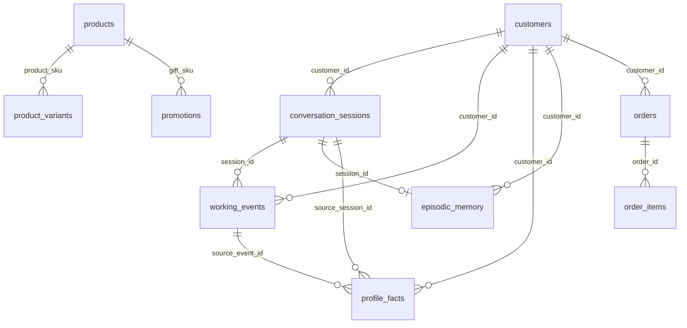

> Archived on 2026-10-28. This file is not a current schema. See `docs/database/schema.md`.

# SC2026 — Database Schema mục tiêu (bản đơn giản hóa)

> Trạng thái: **đề xuất thiết kế**, chưa áp dụng lên Supabase live. Tài liệu này mô tả schema mục tiêu để review và làm cơ sở tạo migration. Không chạy trực tiếp toàn bộ tài liệu như migration.
>
> Nguyên tắc: (1) thông tin khách hàng nằm trong **một bảng `customers`**; (2) không tạo bảng `session_slots`; (3) profile memory chỉ dùng **một bảng `profile_facts`**; (4) đơn hàng có bảng nghiệp vụ riêng; (5) không tạo bảng trùng với session, working memory, episodic memory, catalog hoặc LangGraph checkpoint đang có.

## 1. Danh sách bảng mục tiêu

| Nhóm | Bảng | Trạng thái / mục đích |
|---|---|---|
| CRM | `customers` | Một bảng lưu hồ sơ, các định danh đa kênh và một địa chỉ mặc định của mỗi khách hàng |
| Đơn hàng | `orders` | Đơn hàng, trạng thái, ngày đặt, tracking và tổng tiền |
| Đơn hàng | `order_items` | Các sản phẩm và giá tại thời điểm đặt hàng |
| Session | `conversation_sessions` | Vòng đời phiên và snapshot Call Brief |
| Working memory | `working_events` | Log từng lượt, payload/tool trace theo phiên |
| Profile memory | `profile_facts` | Một bản ghi hiện hành cho mỗi cặp khách hàng + profile key |
| Episodic memory | `episodic_memory` | Tóm tắt phiên đã kết thúc |
| Catalog | `products` | Sản phẩm và thuộc tính tĩnh / thông tin catalog |
| Catalog | `product_variants` | Biến thể sản phẩm |
| Catalog | `promotions` | Khuyến mãi có cấu trúc |
| LangGraph | `checkpoints` | State checkpoint do checkpointer quản lý |
| LangGraph | `checkpoint_writes` | Các write trong checkpoint |
| LangGraph | `checkpoint_blobs` | Blob theo channel/version |
| LangGraph | `checkpoint_migrations` | Phiên bản migration của checkpointer |

Tổng cộng: **14 bảng mục tiêu**. So với live audit gồm 16 bảng hiện tại, thiết kế này gộp `customer_identities` và `customer_addresses` vào `customers`, bỏ `profile_fact_candidates` và `profile_fact_history` khỏi schema hoạt động, thêm `orders` và `order_items`. Không có bảng `session_slots`.

## 2. CRM — `public.customers`

Mỗi khách hàng chỉ có **một dòng**. `phone`, `zalo_id`, `fb_id`, email, vùng miền và địa chỉ mặc định nằm ngay trong bảng này.

| Cột | Kiểu | NULL? | Ràng buộc / mặc định | Ý nghĩa |
|---|---|---:|---|---|
| `customer_id` | `TEXT` | Không | PK | ID ổn định, ví dụ `C019` |
| `full_name` | `TEXT` | Có | — | Họ tên đầy đủ nếu có |
| `preferred_name` | `TEXT` | Có | — | Tên gọi hiển thị; phù hợp với trường `name` hiện có trong seed nếu tên ngắn là tên gọi |
| `honorific` | `TEXT` | Có | — | Xưng hô như `anh`, `chị`, `cô` |
| `phone` | `TEXT` | Có | Index không unique | Số điện thoại đã chuẩn hóa |
| `phone_verified` | `BOOLEAN` | Không | `DEFAULT FALSE` | Số điện thoại đã được xác minh chưa |
| `zalo_id` | `TEXT` | Có | Unique khi khác NULL và khách chưa bị xóa | Định danh Zalo |
| `fb_id` | `TEXT` | Có | Unique khi khác NULL và khách chưa bị xóa | Định danh Facebook |
| `email` | `TEXT` | Có | Unique không phân biệt hoa thường khi khác NULL và khách chưa bị xóa | Email nếu có |
| `region` | `TEXT` | Có | CHECK: `bac`, `trung`, `nam` hoặc NULL | Vùng miền trong CRM seed |
| `address_line` | `TEXT` | Có | — | Địa chỉ mặc định |
| `ward` | `TEXT` | Có | — | Phường/xã |
| `district` | `TEXT` | Có | — | Quận/huyện |
| `city` | `TEXT` | Có | — | Tỉnh/thành phố |
| `country_code` | `CHAR(2)` | Không | `DEFAULT 'VN'` | Mã quốc gia địa chỉ |
| `address_verified` | `BOOLEAN` | Không | `DEFAULT FALSE` | Địa chỉ đã xác minh chưa |
| `status` | `TEXT` | Không | `DEFAULT 'provisional'`; CHECK `active`, `provisional`, `merged`, `deleted` | Trạng thái khách hàng |
| `source` | `TEXT` | Có | — | Nguồn bản ghi, ví dụ `crm_seed` |
| `created_at` | `TIMESTAMPTZ` | Không | `DEFAULT now()` | Thời điểm tạo |
| `updated_at` | `TIMESTAMPTZ` | Không | `DEFAULT now()` | Thời điểm cập nhật |
| `deleted_at` | `TIMESTAMPTZ` | Có | — | Soft delete |

### Index đề xuất cho `customers`

- `idx_customers_phone` trên `phone` (không unique) với điều kiện `phone IS NOT NULL AND deleted_at IS NULL`.
- Unique partial index trên `zalo_id` khi `zalo_id IS NOT NULL AND deleted_at IS NULL`.
- Unique partial index trên `fb_id` khi `fb_id IS NOT NULL AND deleted_at IS NULL`.
- Unique partial index trên `lower(email)` khi `email IS NOT NULL AND deleted_at IS NULL`.
- `idx_customers_region_status` trên `(region, status)` nếu cần lọc theo vùng / trạng thái.

**Shared phone:** không đặt UNIQUE cho `phone`. Khi tra cứu bằng số điện thoại, code phải lấy tất cả khách hàng phù hợp. Nếu trả về nhiều `customer_id`, trả trạng thái `ambiguous`, không tự chọn dòng đầu tiên. Index unique trên Zalo/Facebook/email phải được preflight để phát hiện conflict trước migration.

**Giới hạn của gộp bảng:** mỗi khách hàng chỉ có một địa chỉ mặc định. Nếu sản phẩm thật sự cần nhiều địa chỉ giao hàng cho mỗi khách hàng, mô hình một bảng sẽ không biểu diễn được tất cả các địa chỉ; khi đó cần quyết định lại yêu cầu thay vì tự tạo nhiều dòng customer.

## 3. Đơn hàng — `public.orders`

| Cột | Kiểu | NULL? | Ràng buộc / mặc định | Ý nghĩa |
|---|---|---:|---|---|
| `order_id` | `TEXT` | Không | PK | Mã đơn, ví dụ `OD188213` |
| `customer_id` | `TEXT` | Không | FK → `customers.customer_id`, `ON DELETE RESTRICT` | Chủ đơn hàng |
| `order_date` | `DATE` | Không | — | Ngày đặt trong seed |
| `status` | `TEXT` | Không | — | Trạng thái như `delivered`, `shipping` |
| `tracking_number` | `TEXT` | Có | — | Mã vận đơn |
| `total_amount_vnd` | `BIGINT` | Có | CHECK `>= 0` | Tổng tiền từ nguồn nếu có; không suy ra từ memory |
| `currency` | `CHAR(3)` | Không | `DEFAULT 'VND'` | Đơn vị tiền tệ |
| `source_system` | `TEXT` | Có | Ví dụ `crm_seed` khi import | Nguồn đơn hàng |
| `created_at` | `TIMESTAMPTZ` | Không | `DEFAULT now()` | Thời điểm ghi vào DB |
| `updated_at` | `TIMESTAMPTZ` | Không | `DEFAULT now()` | Thời điểm cập nhật |

Index: `(customer_id, order_date DESC)` và `tracking_number` nếu có nhu cầu tra cứu theo mã vận đơn.

## 4. Chi tiết đơn hàng — `public.order_items`

| Cột | Kiểu | NULL? | Ràng buộc / mặc định | Ý nghĩa |
|---|---|---:|---|---|
| `order_item_id` | `UUID` | Không | PK, `DEFAULT gen_random_uuid()` | ID dòng hàng |
| `order_id` | `TEXT` | Không | FK → `orders.order_id`, `ON DELETE RESTRICT` | Đơn chứa dòng hàng |
| `line_number` | `INTEGER` | Không | CHECK `> 0` | Thứ tự dòng trong đơn |
| `sku` | `TEXT` | Không | Không bắt buộc FK vào catalog để giữ lịch sử khi SKU biến mất | SKU tại thời điểm đặt hàng |
| `product_name_snapshot` | `TEXT` | Có | — | Tên sản phẩm tại thời điểm đặt hàng |
| `quantity` | `INTEGER` | Không | `DEFAULT 1`, CHECK `> 0` | Số lượng; seed hiện không cung cấp nên importer dùng 1 và ghi rõ giả định |
| `unit_price_vnd` | `BIGINT` | Không | CHECK `>= 0` | Giá mỗi đơn vị |
| `line_total_vnd` | `BIGINT` | Không | CHECK `>= 0` | Tổng tiền dòng |
| `created_at` | `TIMESTAMPTZ` | Không | `DEFAULT now()` | Thời điểm tạo dòng |

Constraint: `UNIQUE(order_id, line_number)`. Seed hiện có một SKU cho mỗi đơn mẫu. Nếu `price_vnd` là giá cho một món và quantity mặc định bằng 1, `unit_price_vnd` và `line_total_vnd` bằng nhau. Xác nhận ý nghĩa giá trước import.

## 5. Phiên hội thoại — `public.conversation_sessions`

| Cột | Kiểu | NULL? | Ràng buộc / mặc định | Ý nghĩa |
|---|---|---:|---|---|
| `session_id` | `TEXT` | Không | PK | ID phiên |
| `customer_id` | `TEXT` | Có | FK → `customers.customer_id`, `ON DELETE RESTRICT` | Khách hàng đã được nhận diện, có thể NULL khi chưa rõ |
| `channel` | `TEXT` | Không | `DEFAULT 'web_chat'` | Kênh như hotline, web chat, Zalo OA |
| `status` | `TEXT` | Không | `DEFAULT 'active'`; CHECK `active`, `ending`, `ended`, `abandoned`, `failed` | Trạng thái phiên |
| `started_at` | `TIMESTAMPTZ` | Không | `DEFAULT now()` | Bắt đầu phiên |
| `last_activity_at` | `TIMESTAMPTZ` | Không | `DEFAULT now()` | Lượt gần nhất |
| `ended_at` | `TIMESTAMPTZ` | Có | — | Kết thúc phiên |
| `finalized_at` | `TIMESTAMPTZ` | Có | — | Hoàn tất persistence |
| `outcome` | `TEXT` | Có | — | Kết quả phiên |
| `handoff_reason` | `TEXT` | Có | — | Lý do chuyển người thật |
| `call_brief_json` | `JSONB` | Có | — | Snapshot Call Brief |
| `call_brief_revision` | `INTEGER` | Không | `DEFAULT 0`, CHECK `>= 0` | Revision Call Brief |
| `call_brief_updated_at` | `TIMESTAMPTZ` | Có | — | Lần cập nhật Call Brief |
| `created_at` | `TIMESTAMPTZ` | Không | `DEFAULT now()` | Thời điểm tạo bản ghi |
| `updated_at` | `TIMESTAMPTZ` | Không | `DEFAULT now()` | Thời điểm cập nhật bản ghi |

Index: `(customer_id, started_at DESC)` và `(status, last_activity_at DESC)`.

## 6. Working memory — `public.working_events`

| Cột | Kiểu | NULL? | Ràng buộc / mặc định | Ý nghĩa |
|---|---|---:|---|---|
| `event_id` | `UUID` | Không | PK, `DEFAULT gen_random_uuid()` | ID event |
| `session_id` | `TEXT` | Không | FK → `conversation_sessions.session_id`, `ON DELETE RESTRICT` | Phiên chứa event |
| `turn_id` | `TEXT` | Không | — | ID lượt, dùng idempotency |
| `turn_number` | `INTEGER` | Không | CHECK `>= 1` | Thứ tự lượt |
| `customer_id` | `TEXT` | Có | FK → `customers.customer_id`, `ON DELETE RESTRICT` | Khách đã gắn với lượt; có thể NULL trước khi nhận diện |
| `event_type` | `TEXT` | Không | `DEFAULT 'turn_saved'` | Loại event |
| `event_index` | `INTEGER` | Không | `DEFAULT 0`, CHECK `>= 0` | Thứ tự event trong lượt |
| `payload_json` | `JSONB` | Không | `DEFAULT '{}'::jsonb` | Messages, tool calls/results, identity snapshot và status |
| `created_at` | `TIMESTAMPTZ` | Không | `DEFAULT now()` | Thời điểm ghi event |

Constraint: `UNIQUE(session_id, turn_id)` và `UNIQUE(session_id, turn_number)`. Index: `(session_id, turn_number, created_at)` và `(customer_id, created_at)`.

## 7. Profile memory đơn giản — `public.profile_facts`

**Chỉ một bảng profile memory đang hoạt động.** Không có `profile_fact_candidates`, không có `profile_fact_history`, không có `session_slots` trong mô hình mục tiêu này.

Mỗi cặp `(customer_id, profile_key)` lưu một giá trị hiện hành. Ví dụ: khách hàng có thể có key `room_area_m2`, `budget_vnd`, `has_young_children` hoặc `preferred_size`.

| Cột | Kiểu | NULL? | Ràng buộc / mặc định | Ý nghĩa |
|---|---|---:|---|---|
| `customer_id` | `TEXT` | Không | PK một phần; FK → `customers.customer_id`, `ON DELETE RESTRICT` | Chủ profile fact |
| `profile_key` | `TEXT` | Không | PK một phần | Tên fact ổn định |
| `profile_value` | `JSONB` | Không | — | Giá trị linh hoạt |
| `source_session_id` | `TEXT` | Có | FK → `conversation_sessions.session_id`, `ON DELETE RESTRICT` | Phiên nguồn gần nhất |
| `source_event_id` | `UUID` | Có | FK → `working_events.event_id`, `ON DELETE RESTRICT` | Event nguồn gần nhất nếu có |
| `source_kind` | `TEXT` | Không | `DEFAULT 'customer_stated'` | Nguồn/loại bằng chứng |
| `confidence` | `NUMERIC(4,3)` | Có | CHECK từ 0 đến 1 | Độ tin cậy nếu có đánh giá |
| `updated_at` | `TIMESTAMPTZ` | Không | `DEFAULT now()` | Lần cập nhật gần nhất |

PK: `(customer_id, profile_key)`. Index: `(source_session_id)` và nếu truy vấn theo khách hàng thường xuyên thì PK đã hỗ trợ việc đó.

### Quy tắc ghi profile facts

1. Gate/LLM ở application layer quyết định fact nào đủ bền vững và đủ căn cứ để lưu.
2. Chỉ ghi sau khi fact được chấp nhận; không lưu mọi câu người dùng nói.
3. Khi cùng key có giá trị mới hợp lệ, UPSERT lên dòng hiện tại và cập nhật provenance gần nhất.
4. Slot tạm của một phiên vẫn nằm trong graph state/checkpoint và working-event payload, **không tạo bảng `session_slots`**.
5. Vì không có bảng history, bảng này chỉ giữ giá trị và nguồn cập nhật gần nhất. Nếu sau này yêu cầu audit từng thay đổi, hãy thêm history sau khi có yêu cầu rõ, thay vì giữ đồng thời nhiều tầng khi chưa cần.

## 8. Episodic memory — `public.episodic_memory`

Một episode cho mỗi phiên đã hoàn thành.

| Cột | Kiểu | NULL? | Ràng buộc / mặc định | Ý nghĩa |
|---|---|---:|---|---|
| `episode_id` | `UUID` | Không | PK, `DEFAULT gen_random_uuid()` | ID episode |
| `session_id` | `TEXT` | Không | UNIQUE; FK → `conversation_sessions.session_id`, `ON DELETE RESTRICT` | Mỗi session tối đa một episode hiện hành |
| `customer_id` | `TEXT` | Có | FK → `customers.customer_id`, `ON DELETE RESTRICT` | Khách liên quan |
| `summary` | `TEXT` | Không | — | Tóm tắt phiên |
| `current_need` | `TEXT` | Có | — | Nhu cầu chính |
| `outcome` | `TEXT` | Có | — | Kết quả phiên |
| `handoff_reason` | `TEXT` | Có | — | Lý do chuyển giao |
| `products_advised` | `JSONB` | Không | `DEFAULT '[]'::jsonb` | Các sản phẩm đã tư vấn |
| `orders_summary` | `JSONB` | Không | `DEFAULT '[]'::jsonb` | Tóm tắt hành động đơn hàng trong episode, không phải nguồn đơn hàng chính thức |
| `open_questions` | `JSONB` | Không | `DEFAULT '[]'::jsonb` | Câu hỏi còn mở |
| `open_blockers` | `JSONB` | Không | `DEFAULT '[]'::jsonb` | Trở ngại chưa xử lý |
| `next_actions` | `JSONB` | Không | `DEFAULT '[]'::jsonb` | Hành động tiếp theo |
| `source_event_ids` | `UUID[]` | Không | `DEFAULT '{}'` | Các event tạo episode |
| `turn_count` | `INTEGER` | Không | `DEFAULT 0`, CHECK `>= 0` | Số lượt |
| `started_at` | `TIMESTAMPTZ` | Có | — | Thời điểm bắt đầu nếu biết |
| `ended_at` | `TIMESTAMPTZ` | Không | — | Thời điểm kết thúc |
| `payload_json` | `JSONB` | Có | — | Payload bổ sung, tránh dùng để sao chép dữ liệu nghiệp vụ có nguồn chính thức |
| `created_at` | `TIMESTAMPTZ` | Không | `DEFAULT now()` | Thời điểm ghi |
| `updated_at` | `TIMESTAMPTZ` | Không | `DEFAULT now()` | Thời điểm cập nhật |

Index: `(customer_id, ended_at DESC)` và `(ended_at DESC)`.

## 9. Catalog

### `public.products`

| Cột | Kiểu | NULL? | Ràng buộc / mặc định |
|---|---|---:|---|
| `sku` | `VARCHAR` | Không | PK |
| `name` | `VARCHAR` | Không | — |
| `category` | `VARCHAR` | Có | — |
| `brand` | `VARCHAR` | Có | — |
| `list_price_vnd` | `BIGINT` | Không | `DEFAULT 0` |
| `attributes` | `JSONB` | Có | — |
| `min_price` | `BIGINT` | Có | `DEFAULT 0` |
| `max_price` | `BIGINT` | Có | `DEFAULT 0` |
| `total_stock` | `INTEGER` | Có | — |
| `in_stock` | `BOOLEAN` | Có | — |
| `is_active` | `BOOLEAN` | Có | `DEFAULT TRUE` |
| `created_at` | `TIMESTAMPTZ` | Có | `DEFAULT now()` |
| `updated_at` | `TIMESTAMPTZ` | Có | `DEFAULT now()` |

### `public.product_variants`

| Cột | Kiểu | NULL? | Ràng buộc / mặc định |
|---|---|---:|---|
| `variant_sku` | `VARCHAR` | Không | PK |
| `product_sku` | `VARCHAR` | Không | FK → `products.sku` |
| `size` | `VARCHAR` | Có | — |
| `color` | `VARCHAR` | Có | — |
| `price_delta_vnd` | `BIGINT` | Có | `DEFAULT 0` |
| `stock` | `INTEGER` | Không | `DEFAULT 0` |
| `created_at` | `TIMESTAMPTZ` | Có | `DEFAULT now()` |
| `updated_at` | `TIMESTAMPTZ` | Có | `DEFAULT now()` |

### `public.promotions`

| Cột | Kiểu | NULL? | Ràng buộc / mặc định |
|---|---|---:|---|
| `promo_code` | `VARCHAR` | Không | PK |
| `name` | `VARCHAR` | Không | — |
| `applies_to` | `TEXT[]` | Không | — |
| `type` | `VARCHAR` | Không | — |
| `gift_sku` | `VARCHAR` | Có | FK → `products.sku` |
| `discount_vnd` | `BIGINT` | Có | `DEFAULT 0` |
| `discount_percent` | `INTEGER` | Có | `DEFAULT 0` |
| `min_order_vnd` | `BIGINT` | Có | `DEFAULT 0` |
| `start_date` | `DATE` | Không | — |
| `end_date` | `DATE` | Không | — |
| `stackable` | `BOOLEAN` | Có | `DEFAULT FALSE` |
| `conditions` | `JSONB` | Có | — |
| `created_at` | `TIMESTAMPTZ` | Có | `DEFAULT now()` |
| `updated_at` | `TIMESTAMPTZ` | Có | `DEFAULT now()` |

Giá, stock và khuyến mãi hiện thời phải được đọc từ các bảng có cấu trúc này, không xem vector payload là nguồn giá/chính sách chính thức.

## 10. LangGraph checkpoint tables

Các bảng này do phiên bản LangGraph checkpointer cài đặt/quản lý. Không tự thay đổi schema thủ công ngoài migration/upgrade được library hỗ trợ.

### `public.checkpoints`

| Cột | Kiểu | NULL? | Ràng buộc |
|---|---|---:|---|
| `thread_id` | `TEXT` | Không | PK một phần |
| `checkpoint_ns` | `TEXT` | Không | PK một phần, mặc định chuỗi rỗng |
| `checkpoint_id` | `TEXT` | Không | PK một phần |
| `parent_checkpoint_id` | `TEXT` | Có | — |
| `type` | `TEXT` | Có | — |
| `checkpoint` | `JSONB` | Không | — |
| `metadata` | `JSONB` | Không | — |

PK: `(thread_id, checkpoint_ns, checkpoint_id)`.

### `public.checkpoint_writes`

| Cột | Kiểu | NULL? | Ràng buộc |
|---|---|---:|---|
| `thread_id` | `TEXT` | Không | PK một phần |
| `checkpoint_ns` | `TEXT` | Không | PK một phần, mặc định chuỗi rỗng |
| `checkpoint_id` | `TEXT` | Không | PK một phần |
| `task_id` | `TEXT` | Không | PK một phần |
| `idx` | `INTEGER` | Không | PK một phần |
| `channel` | `TEXT` | Không | — |
| `type` | `TEXT` | Có | — |
| `blob` | `BYTEA` | Không | — |
| `task_path` | `TEXT` | Không | mặc định chuỗi rỗng |

PK: `(thread_id, checkpoint_ns, checkpoint_id, task_id, idx)`.

### `public.checkpoint_blobs`

| Cột | Kiểu | NULL? | Ràng buộc |
|---|---|---:|---|
| `thread_id` | `TEXT` | Không | PK một phần |
| `checkpoint_ns` | `TEXT` | Không | PK một phần, mặc định chuỗi rỗng |
| `channel` | `TEXT` | Không | PK một phần |
| `version` | `TEXT` | Không | PK một phần |
| `type` | `TEXT` | Không | — |
| `blob` | `BYTEA` | Có | — |

PK: `(thread_id, checkpoint_ns, channel, version)`.

### `public.checkpoint_migrations`

| Cột | Kiểu | NULL? | Ràng buộc |
|---|---|---:|---|
| `v` | `INTEGER` | Không | PK |

## 11. ERD tổng quát

Quan hệ shared-phone **không** được biểu diễn bằng bảng quan hệ nữa: tra cứu `customers.phone` có thể trả nhiều customer rows; code chịu trách nhiệm phát hiện và trả `ambiguous`.

## 12. Những thứ bị loại khỏi schema mục tiêu

- `customer_identities`: các cột phone/Zalo/Facebook/email được gộp vào `customers`.
- `customer_addresses`: một địa chỉ mặc định được gộp vào `customers`.
- `profile_fact_candidates`: việc xét duyệt fact ở application Write Gate, không cần bảng candidate riêng trong thiết kế gọn.
- `profile_fact_history`: bỏ lịch sử từng thay đổi khỏi schema hoạt động; `profile_facts` chỉ giữ giá trị hiện hành và provenance gần nhất.
- `session_slots`: không tạo; slot tạm giữ trong graph state/checkpoint và working-event payload.

## 13. Lưu ý quan trọng trước khi migration

1. Đây là schema **mục tiêu**, không phải mô tả chính xác các bảng live hiện tại.
2. Vì database đang dùng chung cho app và test, **không DROP ngay** `customer_identities`, `customer_addresses`, `profile_fact_candidates` hoặc `profile_fact_history`. Trước tiên cần migration có backup/đối chiếu, chuyển dữ liệu identity/address vào `customers`, rà soát phụ thuộc của code, rồi chỉ xóa bảng cũ ở một migration riêng sau khi xác nhận không còn sử dụng.
3. Trước khi thêm unique index cho `zalo_id`, `fb_id`, `email`, chạy preflight để phát hiện duplicates. Không thêm UNIQUE cho phone vì seed có shared-phone edge case.
4. Cần cập nhật code `crm.get_customer` để truy vấn một bảng `customers` và trả `ambiguous` khi nhiều khách có cùng phone. Không còn join `customer_identities`.
5. Cần refactor `ProfileStore`/`PostgresMemoryStore` để không gọi `profile_fact_history` hoặc `profile_fact_candidates`, không còn dùng `create_all()` để dựng schema runtime. Schema do migrations quản lý.
6. Lưu các session seed có độ chính xác ngày nhưng không có giờ bằng quy ước rõ ràng (ví dụ 00:00 UTC), không bịa giờ thực.
7. `orders` và `order_items` chỉ cho phép lưu/truy vấn dữ liệu khi các tool runtime đã được nối tới chúng; tạo bảng không tự hoàn tất `order.create`, `order.update`, `order.status`.
8. Index, triggers, RLS, policy và grants cần được audit trực tiếp trên Supabase trước khi áp dụng migration. Tài liệu live audit trước đây ghi nhận một số hạng mục này chưa xác minh do lỗi kết nối PostgreSQL.
9. Không đưa thông tin cá nhân hoặc secrets vào log; seed chỉ được nạp sau `--dry-run`, xem trước conflict và xác nhận đúng Supabase project.
