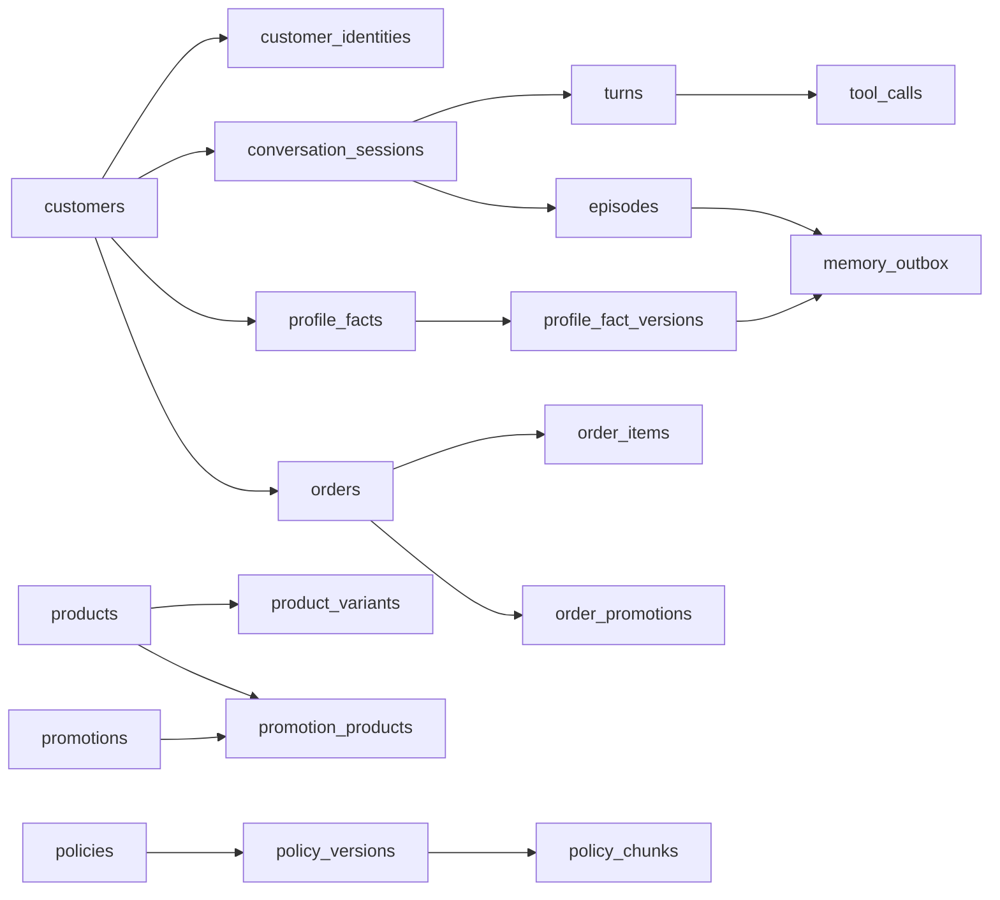

> Archived on 2026-10-28. This file is not a current schema. See `docs/database/schema.md`.

Dưới đây là ví dụ dữ liệu cho **schema rút gọn**. Tất cả tên, ID và nội dung đều là dữ liệu giả. `PK` là khóa chính, `FK` là khóa ngoại. Các cột thời gian giả định dùng `timestamptz`; ngày nghiệp vụ dùng `date`.

Ví dụ dùng chung một khách giả `CUS-001`, phiên `SES-001`, ngày cuộc gọi `2026-10-15`.

## CRM và nhận diện

### `customers` — hồ sơ nội bộ của khách

| Field            | Ví dụ                  | Ý nghĩa                                  |
| ---------------- | ---------------------- | ---------------------------------------- |
| `customer_id` PK | `CUS-001`              | ID nội bộ, được các bảng khác tham chiếu |
| `status`         | `active`               | Trạng thái hồ sơ                         |
| `preferred_name` | `chị Mai`              | Tên gọi được xác nhận                    |
| `created_at`     | `2026-10-10T03:00:00Z` | Thời điểm tạo hồ sơ                      |
| `deleted_at`     | `NULL`                 | Có giá trị khi hồ sơ đã bị xóa/ẩn danh   |

Không lưu số điện thoại trực tiếp trong bảng này nếu định danh được quản lý riêng ở `customer_identities`.

### `customer_identities` — số điện thoại hoặc ID theo kênh

| Field             | Ví dụ      | Ý nghĩa                                 |
| ----------------- | ---------- | --------------------------------------- |
| `identity_id` PK  | `IDN-001`  | ID bản ghi định danh                    |
| `customer_id` FK  | `CUS-001`  | Hồ sơ sở hữu định danh                  |
| `channel`         | `hotline`  | Kênh/loại định danh                     |
| `identifier_hash` | `sha256:…` | Hash để tra cứu mà không lưu giá trị rõ |
| `verified`        | `true`     | Định danh đã xác minh chưa              |

Số điện thoại nên được hash để tìm kiếm; nếu hệ thống phải gọi lại thì cần cơ chế lưu giá trị đã mã hóa riêng. **Không đặt unique cho phone** vì có shared phone. Nếu một phone khớp nhiều `customer_id`, cần hỏi xác nhận trước khi đọc memory.

## Hội thoại và trace

### `conversation_sessions` — một cuộc gọi hoặc phiên chat

| Field                   | Ví dụ                                             | Ý nghĩa                                  |
| ----------------------- | ------------------------------------------------- | ---------------------------------------- |
| `session_id` PK         | `SES-001`                                         | ID phiên                                 |
| `customer_id` FK        | `CUS-001`                                         | Khách đã xác minh; `NULL` khi chưa rõ    |
| `channel`               | `hotline`                                         | `hotline`, `chat_fanpage` hoặc `zalo_oa` |
| `call_date`             | `2026-10-15`                                      | Ngày nghiệp vụ dùng khi gọi tool         |
| `status`                | `ended`                                           | Trạng thái phiên                         |
| `outcome`               | `hen_goi_lai`                                     | Kết quả theo enum của đề                 |
| `call_brief_json`       | `{"customer_name":"chị Mai","stale_warnings":[]}` | Snapshot Call Brief đã dựng              |
| `call_brief_revision`   | `1`                                               | Phiên bản brief                          |
| `call_brief_updated_at` | `2026-10-15T02:05:00Z`                            | Lần cập nhật brief gần nhất              |
| `started_at`            | `2026-10-15T02:00:00Z`                            | Thời điểm bắt đầu                        |
| `ended_at`              | `2026-10-15T02:08:00Z`                            | Thời điểm kết thúc                       |
| `created_at`            | `2026-10-15T02:00:00Z`                            | Thời điểm tạo row                        |
| `updated_at`            | `2026-10-15T02:08:00Z`                            | Lần cập nhật row gần nhất                |

Nếu schema đang chạy có thêm `last_activity_at`, `finalized_at`, `handoff_reason`, giữ các field đó khi code hiện tại cần chúng. Không cần lưu một Call Brief copy ở bảng riêng nếu mỗi phiên chỉ cần snapshot hiện hành.

### `turns` — một lượt khách/agent

| Field                     | Ví dụ                                             | Ý nghĩa                                                  |
| ------------------------- | ------------------------------------------------- | -------------------------------------------------------- |
| `turn_id` PK              | `TURN-001`                                        | ID lượt                                                  |
| `session_id` FK           | `SES-001`                                         | Phiên chứa lượt                                          |
| `turn_number`             | `1`                                               | Thứ tự lượt, unique cùng `session_id`                    |
| `input_masked`            | `Tôi cần nệm cho phòng khoảng [SENSITIVE].`       | Lời khách đã mask PII                                    |
| `normalized_input_masked` | `Tôi cần nệm cho phòng khoảng 20 m2.`             | Văn bản sau chuẩn hóa ASR/teencode                       |
| `assistant_output_masked` | `Dạ, chị muốn chọn kích thước nào ạ?`             | Câu trả lời agent                                        |
| `trace_json`              | `{"questions":[...],"claims":[],"facts_used":[]}` | Trace của lượt: câu hỏi, claim, slot xác nhận, guardrail |
| `ttft_ms`                 | `720`                                             | Thời gian đến token đầu tiên                             |
| `total_latency_ms`        | `2400`                                            | Tổng thời gian xử lý lượt                                |
| `created_at`              | `2026-10-15T02:01:00Z`                            | Thời điểm ghi lượt                                       |

Ghi lượt sau mỗi turn. Không đưa transcript thô có CCCD, STK, phone hoặc địa chỉ vào `trace_json`.

### `tool_calls` — bằng chứng mỗi lần gọi tool

| Field              | Ví dụ                         | Ý nghĩa                        |
| ------------------ | ----------------------------- | ------------------------------ |
| `tool_call_id` PK  | `TC-001`                      | ID lần gọi                     |
| `turn_id` FK       | `TURN-001`                    | Lượt gây ra lần gọi            |
| `tool_name`        | `catalog.search`              | Tên tool                       |
| `arguments_masked` | `{"query":"nệm 1m6"}`         | Tham số đã lọc                 |
| `result_masked`    | `{"items":[{"sku":"NM-01"}]}` | Kết quả đã lọc                 |
| `status`           | `success`                     | `success`, `error`, `timeout`… |
| `duration_ms`      | `180`                         | Thời lượng gọi tool            |

Nếu không cần truy vấn từng lần gọi ở SQL, có thể để tool-call trong `turns.trace_json`. Nếu giữ bảng riêng, tránh lưu lại payload lớn hoặc dữ liệu nhạy cảm.

## Memory khách hàng

### `profile_facts` — giá trị hiện hành theo slot

| Field            | Ví dụ                  | Ý nghĩa                                          |
| ---------------- | ---------------------- | ------------------------------------------------ |
| `fact_id` PK     | `FACT-001`             | ID fact                                          |
| `customer_id` FK | `CUS-001`              | Chủ fact                                         |
| `profile_key`    | `preferred_size`       | Slot ổn định; ví dụ `budget_vnd`, `room_area_m2` |
| `current_value`  | `"1m6"`                | Giá trị đang được chấp nhận                      |
| `status`         | `active`               | `active` hoặc `inactive`                         |
| `valid_from`     | `2026-10-15T02:04:00Z` | Bắt đầu hiệu lực                                 |
| `valid_until`    | `NULL`                 | Hạn hiệu lực nếu có                              |

Đặt unique `(customer_id, profile_key)`. Khi khách đổi ý, cập nhật giá trị hiện tại và đánh dấu version cũ không còn hiệu lực.

### `profile_fact_versions` — nguồn và lịch sử thay đổi fact

| Field                  | Ví dụ                  | Ý nghĩa                            |
| ---------------------- | ---------------------- | ---------------------------------- |
| `version_id` PK        | `FV-001`               | ID phiên bản                       |
| `fact_id` FK           | `FACT-001`             | Fact được thay đổi                 |
| `source_session_id` FK | `SES-001`              | Phiên ghi nhận fact                |
| `source_turn_id` FK    | `TURN-004`             | Lượt làm bằng chứng                |
| `value`                | `"1m6"`                | Giá trị tại version đó             |
| `source_kind`          | `customer_confirmed`   | Nguồn: khách nói, khách xác nhận…  |
| `confidence`           | `0.98`                 | Độ tin cậy nếu hệ thống sử dụng    |
| `accepted`             | `true`                 | Có được Write Gate chấp nhận không |
| `recorded_at`          | `2026-10-15T02:04:00Z` | Thời điểm lưu                      |

Chỉ ghi các fact đã được chấp nhận. Không cần bảng candidate riêng nếu không có quy trình duyệt bất đồng bộ.

### `episodes` — tóm tắt phiên đã kết thúc

| Field              | Ví dụ                                                               | Ý nghĩa                                     |
| ------------------ | ------------------------------------------------------------------- | ------------------------------------------- |
| `episode_id` PK    | `EP-001`                                                            | ID episode                                  |
| `session_id` FK    | `SES-001`                                                           | Phiên tạo episode; nên unique               |
| `customer_id` FK   | `CUS-001`                                                           | Khách của episode                           |
| `summary_masked`   | `Khách hỏi nệm kích thước 1m6, cần kiểm tra mẫu phù hợp.`           | Tóm tắt đã mask                             |
| `useful_context`   | `{"products_advised":["NM-01"],"open_questions":["chưa chọn mẫu"]}` | Nhu cầu, sản phẩm đã tư vấn, câu hỏi còn mở |
| `outcome`          | `hen_goi_lai`                                                       | Kết quả phiên theo enum                     |
| `source_event_ids` | `["EV-001","EV-002"]`                                               | Event dùng để tạo episode, nếu cần truy vết |
| `ended_at`         | `2026-10-15T02:08:00Z`                                              | Thời điểm phiên kết thúc                    |
| `expires_at`       | `2027-04-15T02:08:00Z`                                              | Hạn dùng memory nếu áp dụng TTL             |

Episode là summary, không phải bản sao transcript hay bản ghi đơn hàng chuẩn.

### `memory_outbox` — hàng đợi đồng bộ sang Mem0

Chỉ cần bảng này khi Mem0 được đồng bộ bất đồng bộ.

| Field                | Ví dụ        | Ý nghĩa                                  |
| -------------------- | ------------ | ---------------------------------------- |
| `outbox_id` PK       | `OUT-001`    | ID tác vụ đồng bộ                        |
| `episode_id` FK      | `EP-001`     | Episode cần thêm/cập nhật/xóa trong Mem0 |
| `fact_version_id` FK | `FV-001`     | Hoặc version fact liên quan              |
| `operation`          | `upsert`     | `upsert` hoặc `delete`                   |
| `mem0_memory_id`     | `mem-abc123` | ID memory phía Mem0 sau khi tạo          |
| `status`             | `pending`    | `pending`, `done`, `failed`              |
| `attempts`           | `0`          | Số lần thử                               |

`mem0_user_id` nên lấy từ `customer_id` đã xác minh; không lấy phone/Zalo/FB ID. Outbox chỉ giữ tham chiếu và trạng thái, không lưu một bản copy lớn của memory.

## Đơn hàng và callback

### `orders` — đơn hàng chuẩn

| Field                  | Ví dụ        | Ý nghĩa                               |
| ---------------------- | ------------ | ------------------------------------- |
| `order_id` PK          | `ORD-001`    | ID nội bộ                             |
| `external_order_id`    | `OD123456`   | Mã đơn của hệ thống bán hàng nếu khác |
| `customer_id` FK       | `CUS-001`    | Chủ đơn                               |
| `source_session_id` FK | `SES-001`    | Phiên tạo đơn                         |
| `status`               | `confirmed`  | Trạng thái lấy từ tool/hệ thống đơn   |
| `payment_method`       | `COD`        | Phương thức thanh toán                |
| `total_vnd`            | `4500000`    | Tổng tiền đã xác nhận                 |
| `order_date`           | `2026-10-15` | Ngày đặt                              |

Đơn hàng không được suy ra từ Mem0 hay summary episode.

### `order_items` — sản phẩm trong đơn

| Field                            | Ví dụ                               | Ý nghĩa                       |
| -------------------------------- | ----------------------------------- | ----------------------------- |
| `order_item_id` PK               | `OI-001`                            | ID dòng hàng                  |
| `order_id` FK                    | `ORD-001`                           | Đơn chứa sản phẩm             |
| `sku` FK hoặc tham chiếu         | `NM-01`                             | SKU sản phẩm                  |
| `variant_sku` FK hoặc tham chiếu | `NM-01-160`                         | SKU biến thể nếu có           |
| `quantity`                       | `1`                                 | Số lượng, phải lớn hơn 0      |
| `unit_price_vnd`                 | `4500000`                           | Giá mỗi đơn vị lúc đặt        |
| `line_total_vnd`                 | `4500000`                           | Thành tiền dòng               |
| `product_snapshot`               | `{"name":"Nệm mẫu A","size":"1m6"}` | Snapshot hiển thị lịch sử đơn |

Giá trong order item là snapshot lịch sử, không cập nhật lại theo giá catalog hiện tại.

### `callbacks` — lịch gọi lại đã xác nhận

| Field                  | Ví dụ                  | Ý nghĩa                                       |
| ---------------------- | ---------------------- | --------------------------------------------- |
| `callback_id` PK       | `CB-001`               | ID lịch gọi                                   |
| `customer_id` FK       | `CUS-001`              | Khách cần gọi lại                             |
| `source_session_id` FK | `SES-001`              | Phiên tạo lịch                                |
| `requested_at`         | `2026-10-15T02:06:00Z` | Thời điểm khách yêu cầu                       |
| `scheduled_at`         | `2026-10-19T02:00:00Z` | Thời gian tool đã xác nhận sau khi xử lý lịch |
| `status`               | `scheduled`            | `scheduled`, `completed`, `cancelled`…        |

Agent chỉ xác nhận với khách thời gian do tool trả về.

## Catalog, khuyến mãi và chính sách

Các bảng này chỉ cần nằm trong database agent nếu Supabase là nguồn chuẩn. Nếu nguồn chuẩn là dịch vụ/catalog khác thì tool đọc từ đó, không tạo bản sao gây lệch dữ liệu.

### `products` — thông tin sản phẩm

| Field              | Ví dụ       | Ý nghĩa                    |
| ------------------ | ----------- | -------------------------- |
| `sku` PK           | `NM-01`     | Mã sản phẩm                |
| `name`             | `Nệm mẫu A` | Tên                        |
| `category`         | `nệm`       | Nhóm hàng                  |
| `is_active`        | `true`      | Còn bán không              |
| `successor_sku` FK | `NM-02`     | Mẫu thay thế nếu ngừng bán |

Giá hiện hành, tồn kho và promotion phải có nguồn tool đáng tin cậy; không để vector index hoặc memory làm nguồn giá.

### `product_variants` — biến thể sản phẩm

| Field             | Ví dụ       | Ý nghĩa                |
| ----------------- | ----------- | ---------------------- |
| `variant_sku` PK  | `NM-01-160` | SKU biến thể           |
| `product_sku` FK  | `NM-01`     | Sản phẩm gốc           |
| `size`            | `1m6`       | Kích thước             |
| `color`           | `trắng`     | Màu nếu áp dụng        |
| `price_delta_vnd` | `300000`    | Phụ thu so với giá gốc |

### `promotions` — chương trình khuyến mãi

| Field             | Ví dụ                                         | Ý nghĩa           |
| ----------------- | --------------------------------------------- | ----------------- |
| `promotion_id` PK | `KM-01`                                       | ID chương trình   |
| `name`            | `Tặng gối khi mua nệm`                        | Tên hiển thị      |
| `status`          | `active`                                      | Trạng thái        |
| `starts_on`       | `2026-10-01`                                  | Ngày bắt đầu      |
| `ends_on`         | `2026-10-31`                                  | Ngày kết thúc     |
| `conditions`      | `{"min_quantity":1,"excluded_sizes":["1m2"]}` | Điều kiện áp dụng |
| `benefit`         | `{"type":"gift","sku":"GOI-01"}`              | Quyền lợi         |

Tool phải lọc khuyến mãi chưa bắt đầu và điều kiện không đủ trước khi trả kết quả cho agent.

### `promotion_products` — sản phẩm được áp dụng promotion

| Field                | Ví dụ   | Ý nghĩa          |
| -------------------- | ------- | ---------------- |
| `promotion_id` PK/FK | `KM-01` | Chương trình     |
| `sku` PK/FK          | `NM-01` | Sản phẩm áp dụng |

Khóa chính ghép `(promotion_id, sku)`. Nếu chỉ có ít trường hợp đặc biệt theo variant, có thể giữ danh sách variant trong `conditions`; không cần thêm bảng variant-promotion riêng cho đến khi cần truy vấn SQL thường xuyên.

### `order_promotions` — promotion thực sự áp dụng vào đơn

| Field                  | Ví dụ                   | Ý nghĩa                        |
| ---------------------- | ----------------------- | ------------------------------ |
| `order_id` PK/FK       | `ORD-001`               | Đơn được áp dụng               |
| `promotion_id` PK/FK   | `KM-01`                 | Promotion được áp dụng         |
| `discount_vnd`         | `0`                     | Mức giảm đã được tool xác nhận |
| `application_snapshot` | `{"gift_sku":"GOI-01"}` | Kết quả áp dụng lúc đặt        |

### `policies` — tài liệu/chủ đề chính sách

| Field          | Ví dụ                | Ý nghĩa                                                |
| -------------- | -------------------- | ------------------------------------------------------ |
| `policy_id` PK | `DOI_TRA`            | ID ổn định theo chủ đề                                 |
| `title`        | `Chính sách đổi trả` | Tên tài liệu                                           |
| `visibility`   | `public`             | `public` hoặc `internal`; không đưa internal cho agent |
| `status`       | `active`             | Tài liệu đang được quản lý không                       |

### `policy_versions` — phiên bản và ngày hiệu lực

| Field                  | Ví dụ                     | Ý nghĩa                                 |
| ---------------------- | ------------------------- | --------------------------------------- |
| `policy_version_id` PK | `PV-001`                  | ID phiên bản                            |
| `policy_id` FK         | `DOI_TRA`                 | Tài liệu gốc                            |
| `effective_from`       | `2026-10-01`              | Bắt đầu hiệu lực                        |
| `effective_to`         | `NULL`                    | Kết thúc hiệu lực; `NULL` nếu hiện hành |
| `source_uri`           | `policies/doi-tra-v3.pdf` | Nơi lưu tài liệu chuẩn                  |
| `content_hash`         | `sha256:…`                | Phát hiện file nguồn đã đổi             |

Phải giữ version cũ nếu cần trả lời chính sách tại ngày đặt đơn cũ.

### `policy_chunks` — các đoạn đã chia để tìm kiếm

| Field                  | Ví dụ                        | Ý nghĩa                                   |
| ---------------------- | ---------------------------- | ----------------------------------------- |
| `chunk_id` PK          | `CH-DOITRA-03`               | ID chunk ổn định                          |
| `policy_version_id` FK | `PV-001`                     | Phiên bản chứa đoạn                       |
| `chunk_label`          | `CS-04`                      | Nhãn đoạn dùng trong trace                |
| `access_class`         | `public`                     | Kiểm soát nội dung được truy hồi          |
| `content_or_index_ref` | `qdrant:policy:CH-DOITRA-03` | Nội dung hoặc tham chiếu tới vector index |

Vector database lưu embedding/chỉ mục truy hồi; metadata phiên bản, hiệu lực và quyền truy cập phải có nguồn kiểm soát được. Với tài liệu ít, nội dung chunk có thể nằm trong PostgreSQL; với Qdrant, lưu `chunk_id`/metadata ở đây và embedding ở Qdrant.

## Bảng LangGraph checkpoint

`checkpoints`, `checkpoint_writes`, `checkpoint_blobs`, `checkpoint_migrations` là bảng do LangGraph checkpointer quản lý. Thường **không tự viết nội dung từng field hoặc sửa schema bằng tay**; dùng checkpointer/migration chính thức. `thread_id` liên hệ state của graph, còn `checkpoint_id`, `channel`, `blob` phục vụ khôi phục state.

## Quan hệ chính, tóm tắt

Nếu muốn, bước tiếp theo hợp lý là biến ví dụ này thành **data dictionary chính thức** (tên cột, kiểu dữ liệu, nullability, PK/FK, unique/check) rồi đối chiếu với Supabase live trước khi tạo migration.
