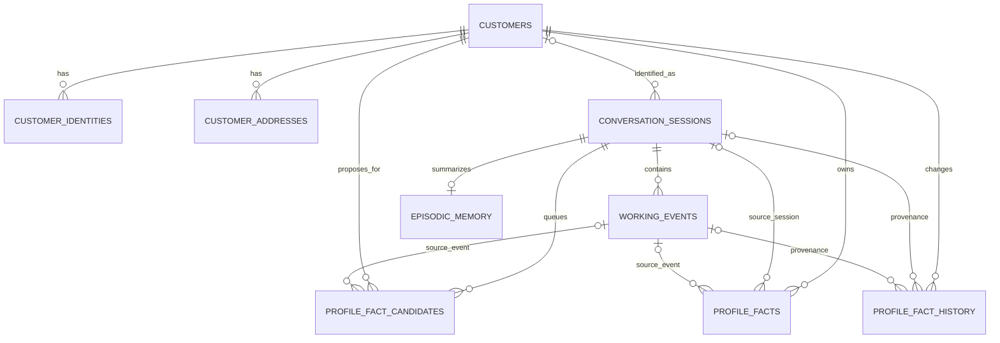
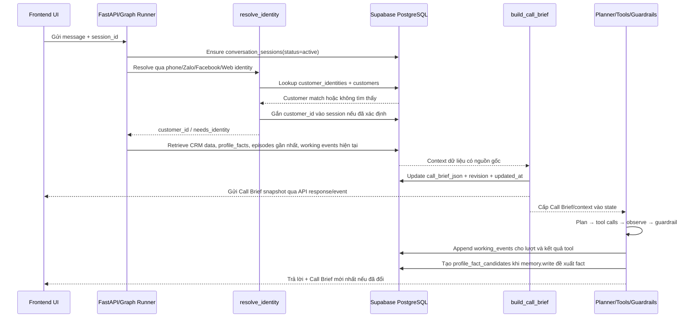
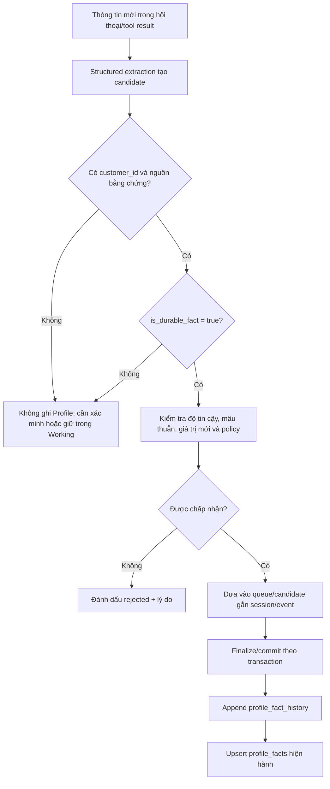
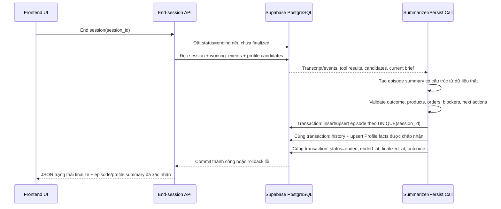

# Database Schema v1 — SUDOTECH Harness Agent Call Center

**Trạng thái:** Bản thiết kế đề xuất để duyệt, chưa phải migration script.  
**Phạm vi:** PostgreSQL/Supabase cho dữ liệu định danh khách hàng và ba lớp memory Working, Profile, Episodic; bao gồm snapshot Call Brief phục vụ UI. Semantic Memory/RAG vẫn nằm ngoài phạm vi này.  
**Nguyên tắc:** Chốt schema và quy tắc đọc/ghi trước khi coding agent sửa code hoặc database.

> **Lưu ý về bằng chứng hiện tại:** File `supabase_memory_dump.md` chỉ xác nhận bốn bảng memory được xuất. Chưa có đủ bằng chứng rằng toàn bộ database không có bảng CRM, customer, address hoặc order khác. Vì vậy, `customers`, `customer_identities`, `customer_addresses` và `conversation_sessions` dưới đây là mô hình logic đích; trước khi triển khai phải đối chiếu inventory đầy đủ và tái sử dụng bảng tương đương nếu đã tồn tại.

## 1. Quyết định kiến trúc v1

1. **PostgreSQL/Supabase là nguồn chuẩn** cho customer identity, session lifecycle và các bảng Working/Profile/Episodic Memory.
2. **Qdrant tiếp tục đảm nhiệm Semantic Memory/RAG** cho chính sách, FAQ và tri thức sản phẩm. Không dùng Profile/Episodic thay cho nguồn dữ liệu giá, khuyến mãi hoặc tồn kho động.
3. `customer_id` phải ổn định xuyên nhiều session. Session chưa nhận diện được khách dùng `customer_id = NULL`, không tạo customer giả có ID `anonymous`.
4. `conversation_sessions.call_brief_json` giữ snapshot Call Brief hiện hành của session. Call Brief là dữ liệu dẫn xuất để agent/nhân viên sử dụng, không phải tầng memory thứ tư.
5. `session_id` được dùng làm LangGraph `thread_id` nếu phù hợp với convention hiện tại; không tạo một ID khác nếu không có lý do kỹ thuật rõ ràng.
6. Profile hiện hành có một fact cho mỗi `(customer_id, profile_key)`. Lịch sử thay đổi nằm trong `profile_fact_history` và là append-only.
7. Mỗi session chỉ có tối đa một episode chính thức; `UNIQUE(session_id)` bảo vệ tính idempotent khi finalize được gọi lại.
8. **Ưu tiên hai Supabase project riêng cho test/dev và application/prod.** Nếu không thể, phải tách schema, connection config và quyền truy cập; chỉ đặt tiền tố `test-` không phải biện pháp cô lập đủ.
9. Khóa khách hàng hiện được dùng dưới dạng chuỗi (`CUST-1029`, v.v.). V1 giữ `customer_id TEXT` để giảm rủi ro tương thích; chỉ đổi kiểu ID khi có kế hoạch migration riêng.
10. Không triển khai DDL dưới đây nguyên trạng trước khi audit toàn bộ bảng, repository và constraint đang có.

## 2. ERD đề xuất



**Diễn giải:**

- Một customer có thể có nhiều identity, address và session.
- Một session có nhiều working events và các đề xuất profile fact đang chờ xử lý.
- Profile fact hiện hành thuộc customer; nguồn gốc có thể liên kết về session/event đã tạo ra nó.
- Episodic Memory được gắn với một session đã finalize thành công.
- Call Brief được lưu ngay trên `conversation_sessions.call_brief_json`; không cần bảng Call Brief riêng ở v1.
- LangGraph checkpointer là hạ tầng state riêng. Bảng checkpoint không thay thế `working_events`, `profile_facts` hay `episodic_memory`.

## 3. Đặc tả bảng và cột

### 3.1 `customers` — Hồ sơ khách hàng chuẩn

Chỉ tạo bảng này nếu audit xác nhận chưa có CRM/customer table tương đương.

| Cột | Kiểu PostgreSQL | Ràng buộc | Mục đích |
|---|---|---|---|
| `customer_id` | `TEXT` | PK, NOT NULL | ID ổn định dùng xuyên phiên và tương thích ID hiện có. |
| `full_name` | `TEXT` | NULL | Họ tên chuẩn nếu đã biết. Không ghi mặc định `Khách hàng` như tên thật. |
| `preferred_name` | `TEXT` | NULL | Tên gọi mong muốn nếu khách cung cấp. |
| `honorific` | `TEXT` | NULL | Cách xưng hô được xác nhận/được CRM cung cấp. |
| `status` | `TEXT` | NOT NULL, default `active`, CHECK `active/provisional/merged/deleted` | Trạng thái hồ sơ. |
| `created_at` | `TIMESTAMPTZ` | NOT NULL, default `now()` | Thời điểm tạo. |
| `updated_at` | `TIMESTAMPTZ` | NOT NULL, default `now()` | Thời điểm cập nhật. |
| `deleted_at` | `TIMESTAMPTZ` | NULL | Soft-delete/ẩn hồ sơ khi cần. |

**Quy tắc:** Không tạo customer chỉ vì chưa tìm được định danh. Khi cần tạo hồ sơ tạm từ dữ liệu chưa xác minh, dùng `provisional` và lưu trạng thái xác minh ở identity; không dùng tên/số điện thoại giả để điền cho đủ.

### 3.2 `customer_identities` — Liên kết định danh đa kênh

| Cột | Kiểu PostgreSQL | Ràng buộc | Mục đích |
|---|---|---|---|
| `identity_id` | `UUID` | PK, default `gen_random_uuid()` | Khóa định danh. |
| `customer_id` | `TEXT` | FK → `customers.customer_id`, NOT NULL, ON DELETE RESTRICT | Khách sở hữu định danh. |
| `identity_type` | `TEXT` | NOT NULL, CHECK nằm trong danh sách được hỗ trợ | Ví dụ `phone`, `zalo_id`, `facebook_id`, `email`, `web_user_id`, `crm_id`. |
| `normalized_value` | `TEXT` | NOT NULL | Giá trị đã chuẩn hóa dùng để lookup. Với số điện thoại phải có chuẩn thống nhất. |
| `display_value` | `TEXT` | NULL | Giá trị hiển thị nếu cần; không đưa vào log debug. |
| `is_verified` | `BOOLEAN` | NOT NULL, default `false` | Định danh đã được xác minh hay chưa. |
| `verified_at` | `TIMESTAMPTZ` | NULL | Thời điểm xác minh. |
| `source` | `TEXT` | NULL | CRM, khách cung cấp, kênh đăng nhập, import, v.v. |
| `created_at` | `TIMESTAMPTZ` | NOT NULL, default `now()` | Thời điểm tạo. |
| `updated_at` | `TIMESTAMPTZ` | NOT NULL, default `now()` | Thời điểm cập nhật. |
| `disabled_at` | `TIMESTAMPTZ` | NULL | Vô hiệu hóa định danh mà vẫn giữ dấu vết. |

**Unique/index:** unique partial index `(identity_type, normalized_value) WHERE disabled_at IS NULL`; index `customer_id`. Một định danh đang hoạt động không được ánh xạ tới hai customer. Không tự động merge hai customer chỉ vì tên giống nhau.

### 3.3 `customer_addresses` — Địa chỉ khách hàng

Chỉ tạo nếu CRM hiện tại chưa có bảng địa chỉ tương đương.

| Cột | Kiểu PostgreSQL | Ràng buộc | Mục đích |
|---|---|---|---|
| `address_id` | `UUID` | PK, default `gen_random_uuid()` | ID địa chỉ. |
| `customer_id` | `TEXT` | FK → `customers.customer_id`, NOT NULL, ON DELETE RESTRICT | Khách sở hữu địa chỉ. |
| `label` | `TEXT` | NULL | Ví dụ nhà, công ty. |
| `recipient_name` | `TEXT` | NULL | Người nhận tại địa chỉ nếu khác khách hàng. |
| `recipient_phone` | `TEXT` | NULL | Số liên hệ giao hàng nếu cần. PII, không log. |
| `address_line` | `TEXT` | NOT NULL | Số nhà/đường/chi tiết địa chỉ. |
| `ward` | `TEXT` | NULL | Phường/xã. |
| `district` | `TEXT` | NULL | Quận/huyện hoặc đơn vị tương ứng. |
| `city` | `TEXT` | NOT NULL | Tỉnh/thành. |
| `country_code` | `CHAR(2)` | NOT NULL, default `VN` | Mã quốc gia ISO. |
| `is_default` | `BOOLEAN` | NOT NULL, default `false` | Địa chỉ mặc định hiện hành. |
| `is_verified` | `BOOLEAN` | NOT NULL, default `false` | Đã xác nhận chưa. |
| `verified_at` | `TIMESTAMPTZ` | NULL | Thời điểm xác minh. |
| `created_at` | `TIMESTAMPTZ` | NOT NULL, default `now()` | Thời điểm tạo. |
| `updated_at` | `TIMESTAMPTZ` | NOT NULL, default `now()` | Thời điểm cập nhật. |
| `deleted_at` | `TIMESTAMPTZ` | NULL | Soft-delete địa chỉ cũ. |

**Unique/index:** index `customer_id`; unique partial index `customer_id WHERE is_default AND deleted_at IS NULL` để mỗi khách có tối đa một địa chỉ mặc định đang hoạt động.

**Quy tắc:** Địa chỉ giao hàng được dùng trong đơn hàng phải được snapshot vào bản ghi đơn hàng hiện có. Không suy ra địa chỉ giao hàng chỉ từ việc khách từng nhắc đến địa chỉ trong hội thoại.

### 3.4 `conversation_sessions` — Vòng đời phiên và Call Brief snapshot

Nếu đã có session table đáp ứng chức năng này, hãy mở rộng/reuse thay vì tạo bảng song song.

| Cột | Kiểu PostgreSQL | Ràng buộc | Mục đích |
|---|---|---|---|
| `session_id` | `TEXT` | PK, NOT NULL | ID session; dùng làm LangGraph `thread_id` nếu theo convention hiện tại. |
| `customer_id` | `TEXT` | FK → `customers.customer_id`, NULL, ON DELETE RESTRICT | NULL khi chưa nhận diện khách. |
| `channel` | `TEXT` | NOT NULL, default `unknown` | `web_chat`, `zalo`, `facebook`, `voice`, v.v. |
| `status` | `TEXT` | NOT NULL, default `active`, CHECK `active/ending/ended/abandoned/failed` | Trạng thái vòng đời. |
| `started_at` | `TIMESTAMPTZ` | NOT NULL, default `now()` | Thời điểm bắt đầu. |
| `last_activity_at` | `TIMESTAMPTZ` | NOT NULL, default `now()` | Hoạt động gần nhất. |
| `ended_at` | `TIMESTAMPTZ` | NULL | Thời điểm người dùng/hệ thống kết thúc phiên. |
| `finalized_at` | `TIMESTAMPTZ` | NULL | Chỉ set khi persistence kết thúc thành công. |
| `outcome` | `TEXT` | NULL | Kết quả phiên, theo bộ outcome chuẩn của ứng dụng. |
| `handoff_reason` | `TEXT` | NULL | Lý do bàn giao nếu có. |
| `call_brief_json` | `JSONB` | NULL, phải là JSON object nếu khác NULL | Snapshot Call Brief mới nhất phục vụ agent và UI. |
| `call_brief_revision` | `INTEGER` | NOT NULL, default `0`, CHECK `>= 0` | Tăng mỗi lần cập nhật snapshot. |
| `call_brief_updated_at` | `TIMESTAMPTZ` | NULL | Thời điểm cập nhật Call Brief. |
| `created_at` | `TIMESTAMPTZ` | NOT NULL, default `now()` | Thời điểm tạo record. |
| `updated_at` | `TIMESTAMPTZ` | NOT NULL, default `now()` | Thời điểm cập nhật record. |

**Index:** `(customer_id, started_at DESC)`; `(status, last_activity_at DESC)`.

**Invariant:** Chỉ chuyển `status` sang `ended` khi bước finalize/persistence đã hoàn tất và `finalized_at` có giá trị. Khi đang ghi dở, dùng `ending`; nếu persistence thất bại, không được trả UI trạng thái đã kết thúc thành công.

### 3.5 `working_events` — Working Memory/Event Log

Tên bảng hiện đã tồn tại; cần migration từ kiểu hiện tại sau khi kiểm tra code truy vấn. Dump hiện tại cho thấy `event_id`, `session_id`, `turn_id`, `turn_number`, `customer_id`, `created_at`, `payload_json`, trong đó timestamp và JSON đang là `VARCHAR`.

| Cột đích | Kiểu PostgreSQL | Ràng buộc | Mục đích |
|---|---|---|---|
| `event_id` | `UUID` | PK, default `gen_random_uuid()` nếu được sinh phía DB | ID sự kiện. Nếu code đã tự sinh ID ổn định, giữ cơ chế đó. |
| `session_id` | `TEXT` | FK → `conversation_sessions.session_id`, NOT NULL, ON DELETE RESTRICT | Session chứa sự kiện. |
| `turn_id` | `TEXT` | NOT NULL | ID ổn định của lượt. |
| `turn_number` | `INTEGER` | NOT NULL, CHECK `>= 1` | Số thứ tự lượt trong session. |
| `event_type` | `TEXT` | NOT NULL | Ví dụ `turn_saved`, `tool_call`, `tool_result`, `profile_fact_candidate`, `handoff`. |
| `event_index` | `INTEGER` | NOT NULL, default `0`, CHECK `>= 0` | Thứ tự của sự kiện cùng loại trong lượt. |
| `payload_json` | `JSONB` | NOT NULL, default `{}` | Dữ liệu event có cấu trúc. Không coi đây là nơi duy nhất chứa hồ sơ chuẩn. |
| `created_at` | `TIMESTAMPTZ` | NOT NULL, default `now()` | Thời gian sự kiện. |

**Unique/index:** unique `(session_id, turn_id, event_type, event_index)` để chống ghi lặp khi retry; index `(session_id, turn_number, created_at)`.

**Chuẩn hóa:** `customer_id` được xác định chuẩn từ `conversation_sessions`. Nếu cần giữ cột `customer_id` hiện hữu nhằm tương thích hoặc truy vấn nhanh, phải coi nó là cột snapshot/denormalized, có chính sách đồng bộ rõ ràng và không được dùng thay quan hệ session chuẩn. Không lưu chuỗi `anonymous` làm customer ID; dùng SQL `NULL` khi chưa xác định.

### 3.6 `profile_fact_candidates` — Fact chờ qua Write Gate

Bảng staging đề xuất để các fact được đề xuất trong hội thoại có thể truy vết và không bị mất nếu session state thay đổi trước khi finalize. Đây là bảng workflow, **không phải memory layer thứ tư**.

| Cột | Kiểu PostgreSQL | Ràng buộc | Mục đích |
|---|---|---|---|
| `candidate_id` | `UUID` | PK, default `gen_random_uuid()` | ID candidate. |
| `session_id` | `TEXT` | FK → `conversation_sessions.session_id`, NOT NULL, ON DELETE RESTRICT | Session nguồn. |
| `customer_id` | `TEXT` | FK → `customers.customer_id`, NOT NULL, ON DELETE RESTRICT | Khách đã nhận diện; không tạo candidate profile khi chưa có khách rõ ràng. |
| `profile_key` | `TEXT` | NOT NULL | Slot cần cập nhật, ví dụ `budget_preference`. |
| `proposed_value` | `JSONB` | NOT NULL | Giá trị được trích xuất. |
| `is_durable_fact` | `BOOLEAN` | NOT NULL | Kết quả structured extraction/Write Gate. |
| `confidence` | `NUMERIC(4,3)` | NULL, CHECK từ `0` đến `1` | Độ tin cậy nếu extractor cung cấp. |
| `source_event_id` | `UUID` | FK → `working_events.event_id`, NULL, ON DELETE RESTRICT | Event làm bằng chứng. |
| `status` | `TEXT` | NOT NULL, default `pending`, CHECK `pending/committed/rejected` | Trạng thái xử lý. |
| `decision_reason` | `TEXT` | NULL | Lý do chấp nhận/từ chối. |
| `created_at` | `TIMESTAMPTZ` | NOT NULL, default `now()` | Thời điểm tạo candidate. |
| `resolved_at` | `TIMESTAMPTZ` | NULL | Thời điểm xử lý xong. |

**Index:** `(session_id, status)`; `(customer_id, profile_key, created_at DESC)`; unique idempotency key theo quy ước event/candidate của application. Không áp một unique constraint suy đoán lên các cột có thể NULL; agent phải chọn idempotency key thật từ code trước khi migration.

**Quy tắc:** `memory.write` ghi candidate. Candidate chỉ được commit khi `is_durable_fact = true`, nguồn gốc hợp lệ và qua các kiểm tra chống mâu thuẫn/ghi đè không có căn cứ. Candidate `rejected` vẫn có trạng thái và lý do để truy vết, nhưng không trở thành profile hiện hành.

### 3.7 `profile_facts` — Profile Memory hiện hành

Bảng hiện tại có 5 bản ghi, tất cả `profile_key = size`; `profile_value_json` hiện là `VARCHAR`. Schema đích chuyển giá trị sang `JSONB` và giữ một record hiện hành cho mỗi customer/key.

| Cột đích | Kiểu PostgreSQL | Ràng buộc | Mục đích |
|---|---|---|---|
| `customer_id` | `TEXT` | PK một phần, FK → `customers.customer_id`, NOT NULL, ON DELETE RESTRICT | Chủ sở hữu fact. |
| `profile_key` | `TEXT` | PK một phần, NOT NULL | Tên slot; normalized lowercase snake_case. |
| `profile_value` | `JSONB` | NOT NULL | Giá trị hiện hành. |
| `source_session_id` | `TEXT` | FK → `conversation_sessions.session_id`, NULL, ON DELETE RESTRICT | Session nguồn gần nhất. NULL cho import/CRM. |
| `source_event_id` | `UUID` | FK → `working_events.event_id`, NULL, ON DELETE RESTRICT | Event nguồn gần nhất. |
| `source_kind` | `TEXT` | NOT NULL, CHECK theo bộ nguồn được hỗ trợ | Ví dụ `customer_stated`, `crm`, `agent_extracted`, `imported`. |
| `confidence` | `NUMERIC(4,3)` | NULL, CHECK từ `0` đến `1` | Độ tin cậy nếu có. |
| `updated_at` | `TIMESTAMPTZ` | NOT NULL, default `now()` | Lần cập nhật hiện hành gần nhất. |

**PK:** `(customer_id, profile_key)`. **Index:** `(source_session_id)` và truy vấn customer theo customer_id được phục vụ bởi PK.

**Quy tắc:** Profile không phải CRM thu nhỏ. Tên/định danh chuẩn nên đến từ customer/CRM; địa chỉ đến từ addresses/CRM; Profile ưu tiên fact bền vững có ích qua phiên như ngân sách thường quan tâm, brand preference, diện tích phòng hoặc tính năng ưu tiên. Không tự biến yêu cầu nhất thời thành sở thích dài hạn.

### 3.8 `profile_fact_history` — Lịch sử thay đổi Profile

Bảng hiện tại có 10 dòng lịch sử. Giữ mục đích audit, nhưng đổi các trường `old_value_json`/`new_value_json` từ chuỗi sang `JSONB` trong schema đích.

| Cột đích | Kiểu PostgreSQL | Ràng buộc | Mục đích |
|---|---|---|---|
| `history_id` | `BIGINT GENERATED ALWAYS AS IDENTITY` | PK | ID lịch sử. |
| `customer_id` | `TEXT` | FK → `customers.customer_id`, NOT NULL, ON DELETE RESTRICT | Khách sở hữu fact. |
| `profile_key` | `TEXT` | NOT NULL | Slot được thay đổi. |
| `old_value` | `JSONB` | NULL | Giá trị cũ; SQL NULL nghĩa là chưa có giá trị trước đó. |
| `new_value` | `JSONB` | NULL | Giá trị mới; SQL NULL khi invalidated/removed. |
| `change_type` | `TEXT` | NOT NULL, CHECK `created/updated/invalidated/deleted` | Loại thay đổi. |
| `source_session_id` | `TEXT` | FK → `conversation_sessions.session_id`, NULL, ON DELETE RESTRICT | Nguồn thay đổi. |
| `source_event_id` | `UUID` | FK → `working_events.event_id`, NULL, ON DELETE RESTRICT | Event nguồn. |
| `change_reason` | `TEXT` | NULL | Giải thích ngắn gọn về thay đổi. |
| `changed_at` | `TIMESTAMPTZ` | NOT NULL, default `now()` | Thời điểm thay đổi. |

**Index:** `(customer_id, profile_key, changed_at DESC, history_id DESC)`.

**Quy tắc:** Insert history và upsert/delete fact hiện hành phải trong cùng một transaction. History là append-only, không update/delete từng dòng trong luồng nghiệp vụ thông thường.

### 3.9 `episodic_memory` — Tóm tắt phiên đã kết thúc

Bảng hiện tại có 6 episode; trong dữ liệu dump, một số `products_advised`, `orders`, `profile_facts_written` đang rỗng và summary có nội dung quá chung. Schema cần cho phép episode chứa tóm tắt hữu ích nhưng không ép phải có đơn hàng khi không phát sinh.

| Cột đích | Kiểu PostgreSQL | Ràng buộc | Mục đích |
|---|---|---|---|
| `episode_id` | `UUID` | PK, default `gen_random_uuid()` | ID episode. |
| `session_id` | `TEXT` | FK → `conversation_sessions.session_id`, NOT NULL, UNIQUE, ON DELETE RESTRICT | Bảo đảm tối đa một episode chính thức/session. |
| `summary` | `TEXT` | NOT NULL | Tóm tắt thực chất nội dung phiên. |
| `current_need` | `TEXT` | NULL | Nhu cầu chính của khách trong phiên. |
| `outcome` | `TEXT` | NULL | Kết quả theo outcome chuẩn. |
| `handoff_reason` | `TEXT` | NULL | Lý do bàn giao nếu có. |
| `products_advised` | `JSONB` | NOT NULL, default `[]` | SKU/mẫu đã tư vấn kèm dữ liệu cần thiết. |
| `orders_summary` | `JSONB` | NOT NULL, default `[]` | Tóm tắt/liên kết đơn hàng thực tế; không thay bảng orders chuẩn. |
| `open_questions` | `JSONB` | NOT NULL, default `[]` | Câu hỏi còn chờ xử lý. |
| `open_blockers` | `JSONB` | NOT NULL, default `[]` | Trở ngại chưa giải quyết. |
| `next_actions` | `JSONB` | NOT NULL, default `[]` | Việc cần làm tiếp theo. |
| `source_event_ids` | `UUID[]` | NOT NULL, default `{}` | Event nguồn để truy vết. |
| `turn_count` | `INTEGER` | NOT NULL, default `0`, CHECK `>= 0` | Số lượt thuộc session. |
| `started_at` | `TIMESTAMPTZ` | NULL | Thời điểm bắt đầu được xác định. |
| `ended_at` | `TIMESTAMPTZ` | NOT NULL | Thời điểm kết thúc đã xác nhận. |
| `created_at` | `TIMESTAMPTZ` | NOT NULL, default `now()` | Thời điểm tạo episode. |
| `updated_at` | `TIMESTAMPTZ` | NOT NULL, default `now()` | Thời điểm sửa nếu có cơ chế chỉnh episode. |

**Index:** `ended_at DESC`; truy xuất theo khách dùng join `episodic_memory.session_id → conversation_sessions.session_id`, sau đó lọc `conversation_sessions.customer_id` và sắp xếp theo `ended_at DESC`. Index `(customer_id, ended_at DESC)` chỉ được thêm nếu audit chứng minh việc lưu `customer_id` denormalized trong episode thực sự cần thiết và có invariant đồng bộ.

**Quy tắc:** Tạo episode chỉ sau khi finalize có dữ liệu thực; `UNIQUE(session_id)` và logic upsert/return existing episode làm finalize idempotent. Summary phải chứa những gì đã diễn ra, không chỉ câu mặc định “phiên hoàn thành”.

## 4. Các chỉ mục và constraint cốt lõi

| Bảng | Constraint/index bắt buộc | Mục đích |
|---|---|---|
| `customers` | PK `customer_id` | ID chuẩn, ổn định. |
| `customer_identities` | Unique active `(identity_type, normalized_value)`; index `customer_id` | Lookup identity và ngăn một định danh gắn hai khách. |
| `customer_addresses` | Index `customer_id`; unique partial địa chỉ mặc định | Tra cứu địa chỉ và tránh nhiều địa chỉ mặc định. |
| `conversation_sessions` | PK `session_id`; index `(customer_id, started_at DESC)`; index `(status, last_activity_at DESC)` | Liệt kê phiên khách và các phiên đang xử lý. |
| `working_events` | PK `event_id`; unique `(session_id, turn_id, event_type, event_index)`; index `(session_id, turn_number, created_at)` | Truy xuất lịch sử lượt và chống event lặp. |
| `profile_fact_candidates` | FK session/customer/source event; index `(session_id, status)` | Theo dõi fact đang chờ Write Gate. |
| `profile_facts` | PK `(customer_id, profile_key)`; confidence trong `[0,1]` nếu có | Một giá trị hiện hành cho mỗi fact. |
| `profile_fact_history` | PK identity; index `(customer_id, profile_key, changed_at DESC, history_id DESC)` | Tra cứu lịch sử thay đổi. |
| `episodic_memory` | `UNIQUE(session_id)`; index `ended_at DESC` | Một episode/session, truy xuất episode mới nhất. |

Tất cả FK nghiệp vụ mặc định `ON DELETE RESTRICT`. Không cascade xóa customer sang memory/history/session vì có thể làm mất dấu vết giao dịch và dữ liệu cần audit.

## 5. Quy tắc sửa/xóa dữ liệu

- **Customer:** Không hard-delete trong luồng nghiệp vụ bình thường. Dùng `status`/`deleted_at`; merge customer phải là thao tác explicit, có audit và cập nhật tất cả identity link an toàn.
- **Identity:** Có thể disable bằng `disabled_at`; không xóa lặng lẽ bằng thao tác thường.
- **Address:** Soft-delete địa chỉ cũ. Một đơn hàng phải giữ snapshot giao hàng tại thời điểm đặt.
- **Session:** Chuyển trạng thái qua `active → ending → ended`. Chỉ `ended` sau khi persistence hoàn tất. Nếu finalize thất bại, ghi nhận lỗi và cho phép retry mà không giả vờ đã kết thúc.
- **Working events:** Append-only trong hoạt động thường ngày; không sửa lịch sử hội thoại để “làm sạch” dữ liệu. Chính sách retention/anonymization phải là job được kiểm soát riêng.
- **Profile current facts:** Có thể upsert khi fact mới được chấp nhận; khi khách đổi ý, append history rồi cập nhật current row trong cùng transaction. Khi invalidated, ghi history với `change_type='invalidated'`, sau đó xóa current row hoặc dùng trạng thái vô hiệu hóa nếu implementation chọn mô hình đó. V1 này chọn current table chỉ giữ fact hiện hành.
- **Profile history:** Append-only; không xóa riêng một version qua API nghiệp vụ thông thường.
- **Episodic:** Chỉ finalize episode chính thức sau khi session kết thúc; `UNIQUE(session_id)` chống duplicate. Cho phép sửa summary theo quy trình rõ ràng, nhưng không tạo episode thứ hai cho cùng session.
- **PII:** Không log số điện thoại, địa chỉ, raw transcript hay payload nhạy cảm. Xóa/anonymize theo yêu cầu pháp lý hoặc retention phải qua quy trình có kiểm soát; không dùng cascade mặc định.

## 6. ERD vật lý dự kiến và SQL constraint mẫu

Đây là khung minh họa cho constraint quan trọng, **không phải migration được phép chạy nguyên trạng**. Tên bảng/kiểu ID cần đối chiếu code và database đầy đủ trước khi agent tạo migration.

```sql
-- Customer identity lookup: chỉ duy nhất với identity đang hoạt động.
CREATE UNIQUE INDEX IF NOT EXISTS uq_customer_identity_active
ON public.customer_identities (identity_type, normalized_value)
WHERE disabled_at IS NULL;

CREATE INDEX IF NOT EXISTS ix_customer_identity_customer
ON public.customer_identities (customer_id);

CREATE UNIQUE INDEX IF NOT EXISTS uq_customer_default_address
ON public.customer_addresses (customer_id)
WHERE is_default = TRUE AND deleted_at IS NULL;

CREATE INDEX IF NOT EXISTS ix_sessions_customer_started
ON public.conversation_sessions (customer_id, started_at DESC);

CREATE INDEX IF NOT EXISTS ix_sessions_status_activity
ON public.conversation_sessions (status, last_activity_at DESC);

CREATE UNIQUE INDEX IF NOT EXISTS uq_working_event_turn_type_index
ON public.working_events (session_id, turn_id, event_type, event_index);

CREATE INDEX IF NOT EXISTS ix_working_events_session_turn
ON public.working_events (session_id, turn_number, created_at);

-- Profile fact current state: PK (customer_id, profile_key).
-- Episodic: UNIQUE(session_id).
```

Nếu hệ thống đang dùng schema `public` qua PostgREST/Supabase API, ưu tiên giữ cấu trúc truy cập hiện có trong migration đầu. Không chuyển bảng sang schema khác nếu chưa kiểm tra exposed schemas, grants, search_path và client queries.

## 7. Luồng đọc/ghi memory

### 7.1 Mỗi lượt chat — Request/Turn Flow



**Đọc ở mỗi lượt:**

1. Session và customer identity chuẩn.
2. Hồ sơ customer/địa chỉ/đơn hàng khi nghiệp vụ cần.
3. Profile facts đang active của `customer_id`.
4. Tối đa N episode gần nhất của chính customer đó (N có thể cấu hình; đề bài yêu cầu continuity, không bắt buộc một con số cố định).
5. Vài working events gần nhất của session hiện tại, không nạp toàn bộ lịch sử không giới hạn.
6. Semantic Memory được truy vấn riêng từ Qdrant/KB khi cần, không lưu giá/KM động vào profile.

**Ghi ở mỗi lượt:**

- Append event/lượt vào `working_events` với ID/idempotency key ổn định.
- Cập nhật `last_activity_at` của session.
- Rebuild và persist snapshot Call Brief khi dữ liệu cần hiển thị thay đổi, rồi gửi cho UI. Lưu DB không tự động cập nhật UI; API/event phải thực sự truyền payload cho frontend.
- `memory.write` tạo candidate có provenance, không ghi mọi nội dung chat trực tiếp vào `profile_facts`.
- Profile candidate chưa qua Write Gate không được đưa thành fact hiện hành.

### 7.2 Write Gate / cập nhật Profile



Profile Memory chỉ chứa fact bền vững (ví dụ budget preference, preferred brand, room area, feature preferences) khi có bằng chứng thích hợp. Một truy vấn mua hàng cho ngân sách cụ thể không tự động trở thành ngân sách lâu dài. Lịch sử và nguồn gốc phải đủ để giải thích fact được ghi vì sao.

### 7.3 Kết thúc phiên — Finalize Flow



**Yêu cầu idempotency:**

- Nếu session đã `ended` và có episode, lần finalize sau trả lại kết quả hiện có, không tạo episode mới.
- Nếu transaction thất bại, không trả `success` và không chuyển session sang `ended`.
- Không thêm history nếu candidate không làm thay đổi giá trị hiện hành.
- Candidate chỉ chuyển sang `committed` sau khi transaction lưu profile thành công.
- Nếu cần external/Qdrant side effect, PostgreSQL là nguồn chuẩn cho profile facts; lỗi đồng bộ phụ không được làm báo cáo sai rằng DB transaction thất bại hoặc ngược lại.

### 7.4 UI hiển thị Call Brief khách cũ

1. API nhận `session_id` và chạy Identity Resolver.
2. Nếu match một customer duy nhất, retrieve Profile + Episodic + CRM data.
3. Build Call Brief có `customer_id`, customer display name, trạng thái returning, số phiên trước, last session summary, current need, constraints, profile facts, orders/open blockers và suggested next action.
4. Persist snapshot vào `conversation_sessions.call_brief_json`.
5. API trả `call_brief` trong response hoặc phát event có schema rõ ràng; frontend gán state và render Call Brief component ngay.
6. Khi data đổi, increment `call_brief_revision`, cập nhật `call_brief_updated_at` và gửi snapshot mới.
7. Khi refresh/reopen, frontend GET lại session/Call Brief từ backend. Không bắt UI tự truy cập database và không xem việc chỉ lưu JSONB là đã hoàn thành tích hợp UI.
8. Nếu identity không chắc chắn hoặc nhiều match, UI hiển thị trạng thái cần xác minh, không hiện dữ liệu của một khách có thể bị nhầm.

## 8. Cô lập dữ liệu test khỏi dữ liệu ứng dụng

### Phương án khuyến nghị

- Một Supabase project riêng cho `development/test`.
- Một Supabase project riêng cho `application/production`.
- Dùng `APP_ENV` và connection string riêng (ví dụ `TEST_DATABASE_URL`/`DATABASE_URL`); không log giá trị connection string.
- Test runner phải fail-fast nếu không có cấu hình môi trường test rõ ràng; không được fallback sang application database.
- Chạy migration và fixture chỉ trên test project trước. Promotion sang application project cần review và migration có phiên bản.
- Không commit dump chứa PII lên Git. Dữ liệu test nên synthetic; không sao chép production PII vào test.

### Nếu buộc phải dùng một Supabase project

Tách schema `app` và `test`, dùng connection/user permissions rõ ràng, kiểm tra exposed schemas và grants. Không dựa duy nhất vào tên phiên `test-*`, `CUST-P2-*` hoặc cột `is_test`. Kiểm tra mọi query/repository đều truy cập đúng schema. Đây là phương án kém cô lập hơn project riêng.

### Xử lý dữ liệu hiện tại

Dump hiện tại có 67 `working_events`, 6 `episodic_memory`, 5 `profile_facts` và 10 `profile_fact_history`. Trong đó có bản ghi trông như test fixture (`CUST-P2-*`, `SESSION-P2-*`, `session-verify-end`) và session UI đã báo 404 khi finalize. Không xóa hoặc tự chuyển các bản ghi dựa vào prefix đơn thuần. Trước khi migration phải:

1. Backup dữ liệu và kiểm tra schema đầy đủ.
2. Phân loại nguồn dữ liệu bằng session metadata/test scripts/log/code.
3. Map customer/session IDs đúng; `anonymous` chuyển thành NULL ở các vị trí chưa xác định khách, không tạo customer giả.
4. Chuyển timestamp `VARCHAR` sang `TIMESTAMPTZ` sau khi validate mọi giá trị.
5. Chuyển `payload_json`, `profile_value_json`, `old_value_json`, `new_value_json` sang `JSONB` bằng parser/convert có kiểm tra lỗi.
6. Chỉ thêm FK sau khi giải quyết orphan/mismatch. Không tự tạo stub customer để ép FK qua nếu chưa xác minh.
7. Chạy migration trên test project, chạy regression và data reconciliation rồi mới lên application project.

## 9. Tiêu chí nghiệm thu schema v1

1. Một khách quay lại ở session mới được map về cùng `customer_id` qua identity đã xác minh.
2. Session chưa biết khách không tạo customer `anonymous`.
3. `build_call_brief` lấy đúng thông tin CRM, Profile và Episodes của đúng khách, lưu snapshot session và trả snapshot cho UI.
4. Working events được append theo lượt, query theo session nhanh và idempotent khi retry.
5. Profile candidate không có `is_durable_fact=true` không được ghi vào `profile_facts`.
6. Khi fact đổi từ M sang L, bảng hiện hành chỉ giữ L; history giữ M và L theo thời gian.
7. Finalize tạo một episode/session có summary thực chất, outcome, sản phẩm/đơn hàng và việc còn mở khi có dữ liệu.
8. Bấm finalize nhiều lần không tạo episode hoặc history duplicate.
9. Persistence lỗi thì UI không hiển thị session đã kết thúc thành công.
10. Chạy test không thể ghi vào application/production database khi cấu hình test bị thiếu hoặc sai.
11. Dữ liệu Semantic Memory/RAG tiếp tục tách riêng; giá, khuyến mãi và tồn kho truy vấn nguồn nghiệp vụ, không lấy từ Profile Memory.
12. Migration có backup, versioning, rollback plan và kiểm tra orphan/row-count trước khi xóa hoặc đổi bảng cũ.

## 10. Thứ tự triển khai khuyến nghị

1. Audit toàn bộ schema, repository, FastAPI endpoints, frontend Call Brief và checkpointer hiện tại.
2. Đối chiếu bảng tương đương để quyết định bảng nào giữ, mở rộng hay cần tạo mới.
3. Tạo migration v1 trên môi trường test riêng.
4. Cập nhật repository/schema model và data access theo từng bảng.
5. Nối luồng Identity → Retrieval → Call Brief → UI.
6. Nối per-turn Working events và Profile candidate Write Gate.
7. Nối finalize transaction cho Episodic + Profile History/Profile facts + session state.
8. Chạy kiểm thử nhiều phiên, finalize idempotency, nhận diện sai/mơ hồ và cách ly test data.
9. Chạy data reconciliation rồi mới lên application environment.

## 11. Căn cứ yêu cầu dự án

Thiết kế được định hướng theo nội dung trong `SUDO2026-Baitoan.pdf`: mỗi khách có `customer_id` ổn định qua nhiều cuộc gọi; kiến trúc Memory 3 tầng + RAG; Profile Memory chỉ ghi fact bền vững với `is_durable_fact=true`; `mcp-memory` đọc/ghi Working, Episodic, Profile; UI có Call Brief và Timeline Memory; demo phải thể hiện nhận diện khách cũ và truy xuất memory qua phiên.

**Lưu ý:** Đây là đặc tả đề xuất v1 dựa trên tài liệu yêu cầu, sơ đồ kiến trúc và phần dump hiện có. Nó chưa phải kết quả audit toàn bộ database. Chốt tên bảng/cột và chạy migration chỉ sau khi xác minh bảng CRM/order/session đang tồn tại, API contract và các repository đọc/ghi trong code.
