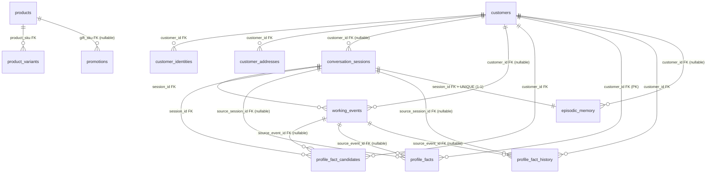

# Audit schema database live v1 — SC2026 tren Supabase

## 1. Thoi diem va phuong phap kiem tra

- Thoi diem: 2026-10-19 (UTC), workspace `D:\SC2026`, branch `ktruc`.
- Phuong phap chinh: **doc metadata live qua Supabase PostgREST/OpenAPI** (`GET /rest/v1/` tra ve 16 definitions: columns, format/type, required, default, PK, FK). Day la introspection truc tiep tu database dang chay, khong phai doc migration.
- Moi bang duoc probe them bang `GET /rest/v1/<table>?select=*&limit=0` (`Prefer: count=none`) — **khong doc bat ky row du lieu nao**, chi lay HTTP status.
- Ket noi direct PostgreSQL (`SUPABASE_DATABASE_URL` -> `db.iphacketssgxcssvrdoq.supabase.co:5432/postgres`) tai thoi diem audit **khong phan giai DNS duoc**; `SUPABASE_POOLER_URL` chua cau hinh. Nen cac truy van `information_schema`/`pg_catalog` (index, trigger, function, sequence, RLS chi tiet) **chua thuc hien duoc** (muc 10).
- Tuan thu gioi han an toan: chi doc metadata; khong migration/DDL/seed; khong INSERT/UPDATE/DELETE/TRUNCATE/DROP; khong in secret; khong in du lieu khach hang/PII; khong commit/push.

## 2. Nguon du lieu va gioi han quyen truy cap

| Nguon | Trang thai | Dung cho |
|---|---|---|
| PostgREST OpenAPI live (`/rest/v1/`, 16 definitions, ~85KB) | DA XAC MINH TRUC TIEP | Columns, kieu du lieu, required/nullable, default, PK, FK cua 16 bang |
| Probe `GET /rest/v1/<table>?select=*&limit=0` cho 12 bang | DA XAC MINH TRUC TIEP | Bang ton tai + API key doc duoc (HTTP 200, body `[]`) |
| `SUPABASE_DATABASE_URL` direct Postgres | DNS fail tai thoi diem audit | Chua doc duoc `pg_indexes`, `pg_trigger`, `pg_proc`, `pg_policies`, sequences |
| `SUPABASE_POOLER_URL` | Chua cau hinh | Chua thu duoc pooler `:6543` |
| `src/memory/migrations/001_schema_v1.sql` | Tham khao repo | Doi chieu ky vong migration v1 |
| `src/memory/working/postgres_store.py` | Tham khao repo | Doi chieu code runtime thuc te |
| `src/tools/tool_repository.py` | Tham khao repo | Doi chieu query customer/catalog |
| `supabase_memory_dump.md` (17/10/2026, local, gitignored) | Lich su, KHONG phai bang chung live | Chi ghi nhan schema `working_events` dang `VARCHAR` don gian thoi diem do |

Cau hinh ket noi (chi ten bien + trang thai, khong in gia tri):

- `SUPABASE_DATABASE_URL` — SET (working/episodic/profile facts + CRM direct SQL). Target an toan: `db.iphacketssgxcssvrdoq.supabase.co:5432/postgres`.
- `SUPABASE_POOLER_URL` — MISSING (optional).
- `SUPABASE_URL` — SET (catalog qua REST).
- `SUPABASE_KEY` — SET (probe doc duoc 12/12 bang).
- `DATABASE_URL` — MISSING (fallback).

## 3. Tong quan schema

- Schema kiem tra: `public` (16 definitions trong OpenAPI = 16 bang duoc expose).
- Tong so bang xac minh live: **16** (9 nghiep vu/memory v1 + 3 catalog + 4 LangGraph checkpoint).
- View / materialized view: **khong phat hien** trong OpenAPI.
- Sequence / function / trigger / index / CHECK / UNIQUE chi tiet: **chua xac minh duoc** — can direct DB.
- Nhom bang: ung dung (9): `customers`, `customer_identities`, `customer_addresses`, `conversation_sessions`, `working_events`, `profile_fact_candidates`, `profile_facts`, `profile_fact_history`, `episodic_memory`; catalog (3): `products`, `product_variants`, `promotions`; workflow (4): `checkpoints`, `checkpoint_writes`, `checkpoint_blobs`, `checkpoint_migrations`.
- Khong phat hien bang don hang (`orders`) — code chi luu `orders_summary JSONB` trong `episodic_memory`.

## 4. Danh sach bang va muc dich su dung

| # | Bang | Nhom | Muc dich | Code su dung |
|---|---|---|---|---|
| 1 | `customers` | CRM | Ho so khach hang, `customer_id TEXT` on dinh | `tool_repository.crm_get_customer`, `ensure_session` |
| 2 | `customer_identities` | CRM | Dinh danh da kenh (phone/zalo/fb/email/web/crm) | `crm_get_customer` (lookup phone) |
| 3 | `customer_addresses` | CRM | Dia chi chuan, 1 default/customer | Chua thay query truc tiep (chi migration) |
| 4 | `conversation_sessions` | Session | Vong doi phien + Call Brief snapshot | `ensure_session`, input_nodes, chat/graph routers |
| 5 | `working_events` | Working memory | Tung luot hoi thoai (`turn`), append-only | `persist_turn_node`, graph_runner, trace |
| 6 | `profile_fact_candidates` | Memory gate | Fact cho qua Write/Durable-Fact Gate | Chua thay query truc tiep (chi migration) |
| 7 | `profile_facts` | Profile memory | Fact hien hanh, PK `(customer_id, profile_key)` | `ProfileStore`, planner/safety nodes |
| 8 | `profile_fact_history` | Audit | Lich su thay doi profile, append-only | `save/get_profile_fact_history` |
| 9 | `episodic_memory` | Episodic | Tom tat phien da ket thuc (1 episode/session) | `persist_call_node`, `get_recent_episodes` |
| 10 | `products` | Catalog | San pham (`sku` PK), gia, ton kho | `tool_repository`, RAG ingestion |
| 11 | `product_variants` | Catalog | Bien the (`variant_sku` PK -> `products.sku`) | `tool_repository` |
| 12 | `promotions` | Catalog | Khuyen mai (`promo_code` PK, `gift_sku` -> `products.sku`) | `tool_repository` (cache 60s) |
| 13 | `checkpoints` | Workflow | LangGraph checkpoint state | `graph/builder.py` (checkpointer) |
| 14 | `checkpoint_writes` | Workflow | Ghi tam tung task trong checkpoint | LangGraph noi bo |
| 15 | `checkpoint_blobs` | Workflow | Blob cua checkpoint channel | LangGraph noi bo |
| 16 | `checkpoint_migrations` | Workflow | Version migration checkpointer (`v` PK) | LangGraph noi bo |

## 5. Chi tiet cot, khoa va constraint tung bang (DA XAC MINH LIVE qua OpenAPI)

Quy uoc: `required` = NOT NULL; `format` = kieu Postgres that; PK/FK tu `description` (`<pk/>`, `<fk table col/>`). CHECK/UNIQUE/index/trigger/function/sequence chi tiet can direct DB (muc 10).

### 5.x `checkpoint_blobs` (6 cot) — PK `thread_id, checkpoint_ns, channel, version`

| Cot | Kieu | NULL? | Default | Ghi chu |
|---|---|---|---|---|
| `thread_id` | `text` | NOT NULL | `None` | PK |
| `checkpoint_ns` | `text` | NOT NULL | `` | PK |
| `channel` | `text` | NOT NULL | `None` | PK |
| `version` | `text` | NOT NULL | `None` | PK |
| `type` | `text` | NOT NULL | `None` |  |
| `blob` | `bytea` | NULL | `None` |  |

### 5.x `checkpoint_migrations` (1 cot) — PK `v`

| Cot | Kieu | NULL? | Default | Ghi chu |
|---|---|---|---|---|
| `v` | `int32` | NOT NULL | `None` | PK |

### 5.x `checkpoint_writes` (9 cot) — PK `thread_id, checkpoint_ns, checkpoint_id, task_id, idx`

| Cot | Kieu | NULL? | Default | Ghi chu |
|---|---|---|---|---|
| `thread_id` | `text` | NOT NULL | `None` | PK |
| `checkpoint_ns` | `text` | NOT NULL | `` | PK |
| `checkpoint_id` | `text` | NOT NULL | `None` | PK |
| `task_id` | `text` | NOT NULL | `None` | PK |
| `idx` | `int32` | NOT NULL | `None` | PK |
| `channel` | `text` | NOT NULL | `None` |  |
| `type` | `text` | NULL | `None` |  |
| `blob` | `bytea` | NOT NULL | `None` |  |
| `task_path` | `text` | NOT NULL | `` |  |

### 5.x `checkpoints` (7 cot) — PK `thread_id, checkpoint_ns, checkpoint_id`

| Cot | Kieu | NULL? | Default | Ghi chu |
|---|---|---|---|---|
| `thread_id` | `text` | NOT NULL | `None` | PK |
| `checkpoint_ns` | `text` | NOT NULL | `` | PK |
| `checkpoint_id` | `text` | NOT NULL | `None` | PK |
| `parent_checkpoint_id` | `text` | NULL | `None` |  |
| `type` | `text` | NULL | `None` |  |
| `checkpoint` | `jsonb` | NOT NULL | `None` |  |
| `metadata` | `jsonb` | NOT NULL | `None` |  |

### 5.x `conversation_sessions` (15 cot) — PK `session_id`

| Cot | Kieu | NULL? | Default | Ghi chu |
|---|---|---|---|---|
| `session_id` | `text` | NOT NULL | `None` | PK |
| `customer_id` | `text` | NULL | `None` | FK Note: This is a Foreign Key to `customers.customer_id`.<fk table='customers' column='customer_id'/> |
| `channel` | `text` | NOT NULL | `web_chat` |  |
| `status` | `text` | NOT NULL | `active` |  |
| `started_at` | `timestamp with time zone` | NOT NULL | `now()` |  |
| `last_activity_at` | `timestamp with time zone` | NOT NULL | `now()` |  |
| `ended_at` | `timestamp with time zone` | NULL | `None` |  |
| `finalized_at` | `timestamp with time zone` | NULL | `None` |  |
| `outcome` | `text` | NULL | `None` |  |
| `handoff_reason` | `text` | NULL | `None` |  |
| `call_brief_json` | `jsonb` | NULL | `None` |  |
| `call_brief_revision` | `int32` | NOT NULL | `0` |  |
| `call_brief_updated_at` | `timestamp with time zone` | NULL | `None` |  |
| `created_at` | `timestamp with time zone` | NOT NULL | `now()` |  |
| `updated_at` | `timestamp with time zone` | NOT NULL | `now()` |  |

### 5.x `customer_addresses` (16 cot) — PK `address_id`

| Cot | Kieu | NULL? | Default | Ghi chu |
|---|---|---|---|---|
| `address_id` | `uuid` | NOT NULL | `gen_random_uuid()` | PK |
| `customer_id` | `text` | NOT NULL | `None` | FK Note: This is a Foreign Key to `customers.customer_id`.<fk table='customers' column='customer_id'/> |
| `label` | `text` | NULL | `None` |  |
| `recipient_name` | `text` | NULL | `None` |  |
| `recipient_phone` | `text` | NULL | `None` |  |
| `address_line` | `text` | NOT NULL | `None` |  |
| `ward` | `text` | NULL | `None` |  |
| `district` | `text` | NULL | `None` |  |
| `city` | `text` | NOT NULL | `None` |  |
| `country_code` | `character` | NOT NULL | `'VN'::bpchar` |  |
| `is_default` | `boolean` | NOT NULL | `False` |  |
| `is_verified` | `boolean` | NOT NULL | `False` |  |
| `verified_at` | `timestamp with time zone` | NULL | `None` |  |
| `created_at` | `timestamp with time zone` | NOT NULL | `now()` |  |
| `updated_at` | `timestamp with time zone` | NOT NULL | `now()` |  |
| `deleted_at` | `timestamp with time zone` | NULL | `None` |  |

### 5.x `customer_identities` (11 cot) — PK `identity_id`

| Cot | Kieu | NULL? | Default | Ghi chu |
|---|---|---|---|---|
| `identity_id` | `uuid` | NOT NULL | `gen_random_uuid()` | PK |
| `customer_id` | `text` | NOT NULL | `None` | FK Note: This is a Foreign Key to `customers.customer_id`.<fk table='customers' column='customer_id'/> |
| `identity_type` | `text` | NOT NULL | `None` |  |
| `normalized_value` | `text` | NOT NULL | `None` |  |
| `display_value` | `text` | NULL | `None` |  |
| `is_verified` | `boolean` | NOT NULL | `False` |  |
| `verified_at` | `timestamp with time zone` | NULL | `None` |  |
| `source` | `text` | NULL | `None` |  |
| `created_at` | `timestamp with time zone` | NOT NULL | `now()` |  |
| `updated_at` | `timestamp with time zone` | NOT NULL | `now()` |  |
| `disabled_at` | `timestamp with time zone` | NULL | `None` |  |

### 5.x `customers` (8 cot) — PK `customer_id`

| Cot | Kieu | NULL? | Default | Ghi chu |
|---|---|---|---|---|
| `customer_id` | `text` | NOT NULL | `None` | PK |
| `full_name` | `text` | NULL | `None` |  |
| `preferred_name` | `text` | NULL | `None` |  |
| `honorific` | `text` | NULL | `None` |  |
| `status` | `text` | NOT NULL | `active` |  |
| `created_at` | `timestamp with time zone` | NOT NULL | `now()` |  |
| `updated_at` | `timestamp with time zone` | NOT NULL | `now()` |  |
| `deleted_at` | `timestamp with time zone` | NULL | `None` |  |

### 5.x `episodic_memory` (19 cot) — PK `episode_id`

| Cot | Kieu | NULL? | Default | Ghi chu |
|---|---|---|---|---|
| `episode_id` | `uuid` | NOT NULL | `gen_random_uuid()` | PK |
| `session_id` | `text` | NOT NULL | `None` | FK Note: This is a Foreign Key to `conversation_sessions.session_id`.<fk table='conversation_sessions' column='se |
| `customer_id` | `text` | NULL | `None` | FK Note: This is a Foreign Key to `customers.customer_id`.<fk table='customers' column='customer_id'/> |
| `summary` | `text` | NOT NULL | `None` |  |
| `current_need` | `text` | NULL | `None` |  |
| `outcome` | `text` | NULL | `None` |  |
| `handoff_reason` | `text` | NULL | `None` |  |
| `products_advised` | `jsonb` | NOT NULL | `None` |  |
| `orders_summary` | `jsonb` | NOT NULL | `None` |  |
| `open_questions` | `jsonb` | NOT NULL | `None` |  |
| `open_blockers` | `jsonb` | NOT NULL | `None` |  |
| `next_actions` | `jsonb` | NOT NULL | `None` |  |
| `source_event_ids` | `uuid[]` | NOT NULL | `None` |  |
| `turn_count` | `int32` | NOT NULL | `0` |  |
| `started_at` | `timestamp with time zone` | NULL | `None` |  |
| `ended_at` | `timestamp with time zone` | NOT NULL | `None` |  |
| `payload_json` | `jsonb` | NULL | `None` |  |
| `created_at` | `timestamp with time zone` | NOT NULL | `now()` |  |
| `updated_at` | `timestamp with time zone` | NOT NULL | `now()` |  |

### 5.x `product_variants` (8 cot) — PK `variant_sku`

| Cot | Kieu | NULL? | Default | Ghi chu |
|---|---|---|---|---|
| `variant_sku` | `character varying` | NOT NULL | `None` | PK |
| `product_sku` | `character varying` | NOT NULL | `None` | FK Note: This is a Foreign Key to `products.sku`.<fk table='products' column='sku'/> |
| `size` | `character varying` | NULL | `None` |  |
| `color` | `character varying` | NULL | `None` |  |
| `price_delta_vnd` | `int64` | NULL | `0` |  |
| `stock` | `int32` | NOT NULL | `0` |  |
| `created_at` | `timestamp with time zone` | NULL | `now()` |  |
| `updated_at` | `timestamp with time zone` | NULL | `now()` |  |

### 5.x `products` (13 cot) — PK `sku`

| Cot | Kieu | NULL? | Default | Ghi chu |
|---|---|---|---|---|
| `sku` | `character varying` | NOT NULL | `None` | PK |
| `name` | `character varying` | NOT NULL | `None` |  |
| `category` | `character varying` | NULL | `None` |  |
| `brand` | `character varying` | NULL | `None` |  |
| `list_price_vnd` | `int64` | NOT NULL | `0` |  |
| `attributes` | `jsonb` | NULL | `None` |  |
| `min_price` | `int64` | NULL | `0` |  |
| `max_price` | `int64` | NULL | `0` |  |
| `total_stock` | `int32` | NULL | `0` |  |
| `in_stock` | `boolean` | NULL | `False` |  |
| `is_active` | `boolean` | NULL | `True` |  |
| `created_at` | `timestamp with time zone` | NULL | `now()` |  |
| `updated_at` | `timestamp with time zone` | NULL | `now()` |  |

### 5.x `profile_fact_candidates` (12 cot) — PK `candidate_id`

| Cot | Kieu | NULL? | Default | Ghi chu |
|---|---|---|---|---|
| `candidate_id` | `uuid` | NOT NULL | `gen_random_uuid()` | PK |
| `session_id` | `text` | NOT NULL | `None` | FK Note: This is a Foreign Key to `conversation_sessions.session_id`.<fk table='conversation_sessions' column='se |
| `customer_id` | `text` | NOT NULL | `None` | FK Note: This is a Foreign Key to `customers.customer_id`.<fk table='customers' column='customer_id'/> |
| `profile_key` | `text` | NOT NULL | `None` |  |
| `proposed_value` | `jsonb` | NOT NULL | `None` |  |
| `is_durable_fact` | `boolean` | NOT NULL | `False` |  |
| `confidence` | `numeric` | NULL | `None` |  |
| `source_event_id` | `uuid` | NULL | `None` | FK Note: This is a Foreign Key to `working_events.event_id`.<fk table='working_events' column='event_id'/> |
| `status` | `text` | NOT NULL | `pending` |  |
| `decision_reason` | `text` | NULL | `None` |  |
| `created_at` | `timestamp with time zone` | NOT NULL | `now()` |  |
| `resolved_at` | `timestamp with time zone` | NULL | `None` |  |

### 5.x `profile_fact_history` (10 cot) — PK `history_id`

| Cot | Kieu | NULL? | Default | Ghi chu |
|---|---|---|---|---|
| `history_id` | `int64` | NOT NULL | `None` | PK |
| `customer_id` | `text` | NOT NULL | `None` | FK Note: This is a Foreign Key to `customers.customer_id`.<fk table='customers' column='customer_id'/> |
| `profile_key` | `text` | NOT NULL | `None` |  |
| `old_value` | `jsonb` | NULL | `None` |  |
| `new_value` | `jsonb` | NULL | `None` |  |
| `change_type` | `text` | NOT NULL | `None` |  |
| `source_session_id` | `text` | NULL | `None` | FK Note: This is a Foreign Key to `conversation_sessions.session_id`.<fk table='conversation_sessions' column='se |
| `source_event_id` | `uuid` | NULL | `None` | FK Note: This is a Foreign Key to `working_events.event_id`.<fk table='working_events' column='event_id'/> |
| `change_reason` | `text` | NULL | `None` |  |
| `changed_at` | `timestamp with time zone` | NOT NULL | `now()` |  |

### 5.x `profile_facts` (8 cot) — PK `customer_id, profile_key`

| Cot | Kieu | NULL? | Default | Ghi chu |
|---|---|---|---|---|
| `customer_id` | `text` | NOT NULL | `None` | PK FK Note: This is a Primary Key.<pk/> This is a Foreign Key to `customers.customer_id`.<fk table='customers' colum |
| `profile_key` | `text` | NOT NULL | `None` | PK |
| `profile_value` | `jsonb` | NOT NULL | `None` |  |
| `source_session_id` | `text` | NULL | `None` | FK Note: This is a Foreign Key to `conversation_sessions.session_id`.<fk table='conversation_sessions' column='se |
| `source_event_id` | `uuid` | NULL | `None` | FK Note: This is a Foreign Key to `working_events.event_id`.<fk table='working_events' column='event_id'/> |
| `source_kind` | `text` | NOT NULL | `customer_stated` |  |
| `confidence` | `numeric` | NULL | `None` |  |
| `updated_at` | `timestamp with time zone` | NOT NULL | `now()` |  |

### 5.x `promotions` (14 cot) — PK `promo_code`

| Cot | Kieu | NULL? | Default | Ghi chu |
|---|---|---|---|---|
| `promo_code` | `character varying` | NOT NULL | `None` | PK |
| `name` | `character varying` | NOT NULL | `None` |  |
| `applies_to` | `text[]` | NOT NULL | `None` |  |
| `type` | `character varying` | NOT NULL | `None` |  |
| `gift_sku` | `character varying` | NULL | `None` | FK Note: This is a Foreign Key to `products.sku`.<fk table='products' column='sku'/> |
| `discount_vnd` | `int64` | NULL | `0` |  |
| `discount_percent` | `int32` | NULL | `0` |  |
| `min_order_vnd` | `int64` | NULL | `0` |  |
| `start_date` | `date` | NOT NULL | `None` |  |
| `end_date` | `date` | NOT NULL | `None` |  |
| `stackable` | `boolean` | NULL | `False` |  |
| `conditions` | `jsonb` | NULL | `None` |  |
| `created_at` | `timestamp with time zone` | NULL | `now()` |  |
| `updated_at` | `timestamp with time zone` | NULL | `now()` |  |

### 5.x `working_events` (9 cot) — PK `event_id`

| Cot | Kieu | NULL? | Default | Ghi chu |
|---|---|---|---|---|
| `event_id` | `uuid` | NOT NULL | `gen_random_uuid()` | PK |
| `session_id` | `text` | NOT NULL | `None` | FK Note: This is a Foreign Key to `conversation_sessions.session_id`.<fk table='conversation_sessions' column='se |
| `turn_id` | `text` | NOT NULL | `None` |  |
| `turn_number` | `int32` | NOT NULL | `None` |  |
| `customer_id` | `text` | NULL | `None` | FK Note: This is a Foreign Key to `customers.customer_id`.<fk table='customers' column='customer_id'/> |
| `event_type` | `text` | NOT NULL | `turn_saved` |  |
| `event_index` | `int32` | NOT NULL | `0` |  |
| `payload_json` | `jsonb` | NOT NULL | `None` |  |
| `created_at` | `timestamp with time zone` | NOT NULL | `now()` |  |

## 6. So do quan he ERD (chi quan he DA XAC MINH qua FK live)

- 1–N: `customers` -> identities/addresses/sessions/events/candidates/facts/history/episodes; `conversation_sessions` -> events/candidates; `products` -> variants/promotions.
- 1–1: `conversation_sessions` — `episodic_memory` (FK + UNIQUE tren `session_id`).
- N–N: khong co bang junction.
- Cot ID khong co FK (chi luu gia tri): `episodic_memory.source_event_ids UUID[]`, `promotions.applies_to TEXT[]`, `checkpoints.parent_checkpoint_id` (logic, khong FK).

## 7. Trang thai RLS va policy

- **Chua xac minh duoc chi tiet RLS/policy** (direct DB fail; PostgREST tra 404 cho `pg_policies`/`rpc/pg_tables`).
- Bang chung gian tiep DA XAC MINH: `SUPABASE_KEY` doc duoc 12/12 bang probe (HTTP 200) — RLS hoac dang tat, hoac co policy SELECT cho role nay; khong phan biet duoc neu khong doc `pg_policies`.
- Khi direct DB khoi phuc: `SELECT tablename, rowsecurity FROM pg_tables WHERE schemaname='public'` va `SELECT * FROM pg_policies WHERE schemaname='public'`.

## 8. Diem khac biet giua database thuc te va repository

### 8.1 Khac biet nghiem trong: code runtime cu khong khop schema live (P0)

`src/memory/working/postgres_store.py` dinh nghia SQLAlchemy `Table` + raw SQL theo **schema cu don gian hoa**, khac schema live v1:

| Van de | Schema live (da verify) | Code repo | Anh huong |
|---|---|---|---|
| `working_events` | 9 cot: `event_id UUID PK`, `event_type`, `event_index`, `payload_json JSONB`, `created_at TIMESTAMPTZ` + FK | 7 cot toan `String`, thieu `event_type/event_index` | Insert thieu cot NOT NULL se dung default DB (co default); `create_all()` khong tan dung constraint |
| `episodic_memory` | 19 cot, PK `episode_id UUID`, UNIQUE `session_id` | 4 cot `String`: `session_id PK`, `customer_id`, `ended_at`, `payload_json` | `ON CONFLICT(session_id)` van chay nho `payload_json`, nhung **bo qua cot phan tich** (`summary`, `products_advised`, `turn_count`...) |
| `profile_facts` | `profile_value JSONB`, `source_session_id` | `profile_value_json`, `provenance_session_id` | Doc co fallback chon cot dong (dung); **`save_profile_facts` ghi theo ten cu -> sai cot tren DB live** |
| `profile_fact_history` | `old_value/new_value JSONB`, `source_session_id`, `change_type`, `change_reason`, `changed_at` | `old_value_json/new_value_json`, `provenance_session_id`, `changed_at` | `save`/`get` history se **sai ten cot** neu khong qua fallback |
| `conversation_sessions` | 15 cot incl. `status/started_at/last_activity_at/call_brief_*` | `ensure_session` chi `INSERT (session_id, customer_id, channel)` | Chay duoc (cot con lai dung default), nhung khong cap nhat `last_activity_at/status` |

### 8.2 Bang repo ky vong nhung chua thay code su dung

- `customer_addresses`, `profile_fact_candidates`: co trong migration v1 + live, grep `src/**/*.py` khong thay query truc tiep.

### 8.3 Bang live nhung code it/khong de cap truc tiep

- `checkpoints*` (4 bang): chi cau hinh checkpointer trong `graph/builder.py` (dung — LangGraph quan ly noi bo).

### 8.4 Schema cu trong dump lich su

- `supabase_memory_dump.md` (17/10, 67 rows `working_events` cot `VARCHAR` don gian) **trai voi schema live hien tai** (UUID/INT/JSONB/TIMESTAMPTZ + FK) -> DB da migrate len v1 sau dump do, hoac dump tu project khac. Khong dung dump cu lam bang chung hien tai.

## 9. Van de can xu ly (uu tien)

| Uu tien | Van de | Hanh dong de xuat (chua thuc hien) |
|---|---|---|
| **P0** | `PostgresMemoryStore` ghi sai ten cot `profile_facts`/`profile_fact_history` vs DB live | Sua `save_*` dung ten v1 (`profile_value`, `source_session_id`, `old/new_value`), giu fallback doc; them test schema v1 that |
| **P0** | `metadata.create_all()` co the tao schema cu de len DB moi | Bo `create_all()` tu dong hoac `checkfirst` + canh bao; migration v1 la nguon duy nhat tao bang |
| **P1** | Chua verify index/trigger/CHECK/UNIQUE/RLS live | Cau hinh `SUPABASE_POOLER_URL` hoac sua DNS direct DB roi chay lai audit `information_schema/pg_catalog` chi-doc |
| **P1** | `ensure_session` khong cap nhat `last_activity_at/status` | Bo sung `ON CONFLICT DO UPDATE SET last_activity_at=now()` |
| **P2** | `customer_addresses`, `profile_fact_candidates` chua co code dung | Quyet dinh: implement hoac ghi out-of-scope v1 |
| **P2** | Khong co bang `orders` rieng | Xac nhan thiet ke: `orders_summary JSONB` da du hay can bang orders v2 |
| **P3** | `supabase_memory_dump.md` chua du lieu that (may la gitignored) | Giu gitignore `*.dump.md`, `reports/`; khong commit file nay |

## 10. Thong tin chua xac minh duoc

1. Index, UNIQUE, CHECK, trigger, function, sequence trong `public` (can direct DB; OpenAPI khong expose).
2. RLS enable + policy `USING`/`WITH CHECK` + GRANT chi tiet.
3. Row count / du lieu mau (co y khong doc theo gioi han an toan).
4. Cac schema ngoai `public` (`auth`, `storage`, extensions).
5. Role chinh xac cua `SUPABASE_KEY` (chi biet doc duoc 12/12 bang probe).
6. Direct DB DNS fail la tam thoi hay cau hinh sai (can kiem tra host `db.iphacketssgxcssvrdoq.supabase.co`, mang/IPv6, hoac pooler `:6543`).

### Bang tra cuu nhanh (live, da verify)

| Bang | PK | FK di ra | Duoc FK toi |
|---|---|---|---|
| `customers` | `customer_id` | — | tu 8 bang |
| `customer_identities` | `identity_id` | `customers` | — |
| `customer_addresses` | `address_id` | `customers` | — |
| `conversation_sessions` | `session_id` | `customers` | tu events, candidates, facts, history, episodic |
| `working_events` | `event_id` | `conversation_sessions`, `customers` | tu candidates, facts, history |
| `profile_fact_candidates` | `candidate_id` | sessions, customers, events | — |
| `profile_facts` | `(customer_id, profile_key)` | customers, sessions, events | — |
| `profile_fact_history` | `history_id` | customers, sessions, events | — |
| `episodic_memory` | `episode_id` (UNIQUE `session_id`) | sessions, customers | — |
| `products` | `sku` | — | tu variants, promotions |
| `product_variants` | `variant_sku` | `products` | — |
| `promotions` | `promo_code` | `products` (gift_sku) | — |
| `checkpoints` | `(thread_id, checkpoint_ns, checkpoint_id)` | — | — |
| `checkpoint_writes` | `(thread_id, ..., idx)` | — | — |
| `checkpoint_blobs` | `(thread_id, checkpoint_ns, channel, version)` | — | — |
| `checkpoint_migrations` | `(v)` | — | — |

---

### Phan loai phat hien

1. **Da xac minh truc tiep tren Supabase:** muc 5 (columns/types/defaults/PK/FK 16 bang), muc 6 (ERD), probe 12/12 HTTP 200.
2. **Chi trong repository, chua xac minh tren database:** CHECK/UNIQUE/index/trigger/function/sequence/RLS chi tiet; query `customer_addresses`, `profile_fact_candidates`.
3. **Khac biet giua database va repository:** muc 8.1 (ten cot `profile_value_json` vs `profile_value`, `provenance_session_id` vs `source_session_id`, `old/new_value_json` vs `old/new_value`; `create_all()` don gian vs v1 day du).
4. **Chua the xac minh do thieu quyen truy cap:** muc 10 (can direct DB/pooler cho `pg_catalog`, RLS, row counts).
