# SC2026 Mock UI — Information Architecture

```mermaid
flowchart TD
  A[SC2026 account portal] --> ADM[Administrator account]
  A --> CUS[Customer account]
  ADM --> W[Agent workspace]
  CUS --> LOGIN[Choose channel + enter name and ID / phone]
  LOGIN --> FB[Facebook Messenger-style conversation]
  LOGIN --> ZALO[Zalo OA-style conversation]
  LOGIN --> PHONE[Phone conversation + audio upload]
  PHONE --> ASR[Local audio player + illustrative ASR]
  FB --> CONV[Demo conversation + end session]
  ZALO --> CONV
  PHONE --> CONV
  CONV --> ITEM[Advised product + illustrative promotion]
  A --> C[Customers]
  A --> P[Products]
  A --> O[Promotions]
  A --> POL[Store policies]
  A --> E[Evaluation]
  A --> I[Improvement]

  W --> W1[Interaction inbox]
  W --> W2[Conversation transcript]
  W --> W3[Customer context / Call Brief]
  W3 --> W31[Overview]
  W3 --> W32[Customer journey]
  W3 --> W33[Case details]

  C --> C1[Search customer directory]
  C --> C2[Customer profile card]
  C2 --> C3[Linked interactions]

  P --> P1[Search and filters]
  P --> P2[Product cards]
  P2 --> P3[Product details]
  P3 --> P4[Price / stock / warranty / features]
  P3 --> P5[Related promotions]

  O --> O1[Search and filters]
  O --> O2[Promotion cards]
  O2 --> O3[Promotion details]
  O3 --> O4[Validity / code / eligibility / terms]
  O3 --> O5[Eligible products]

  POL --> POL1[Search / category / sort]
  POL --> POL2[Current policies]
  POL --> POL3[Archived versions · read-only]
  POL2 --> POL4[Policy details / effective date / owner / approval]
  POL3 --> POL5[Historical policy text / supersession note]
  POL5 --> POL6[Version history by policy topic]
  W2 -. policy question .-> POL4
  W2 -. historical dispute .-> POL5

  E --> E1[Illustrative metrics]
  E --> E2[Scenario runs and evidence modal]
  I --> I1[Recurring issues]
  I --> I2[Memory proposals]
  I --> I3[Iteration comparison]

  W2 -. product question .-> P3
  W2 -. discount question .-> O3
  P5 --> O5
```

> Products, Promotions, and Store policies are reference screens for agents and supervisors. In this prototype they are navigable pages and detail modals; there is no live API or catalog integration. The catalog and policy fixtures are illustrative until approved source data is supplied. Current policy versions and archived versions are shown separately; archive entries are intended for historical lookup, not current customer answers.
