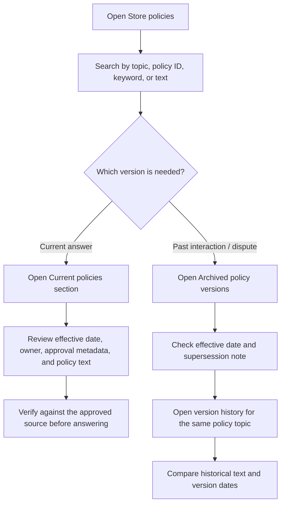
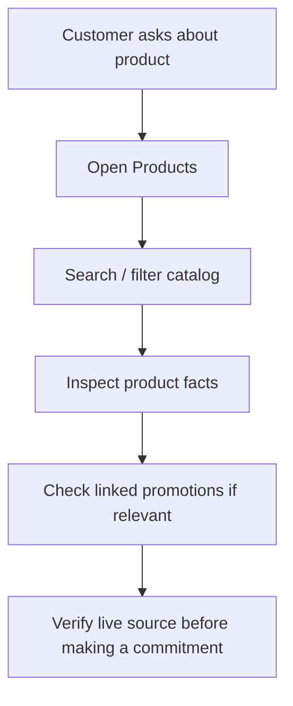
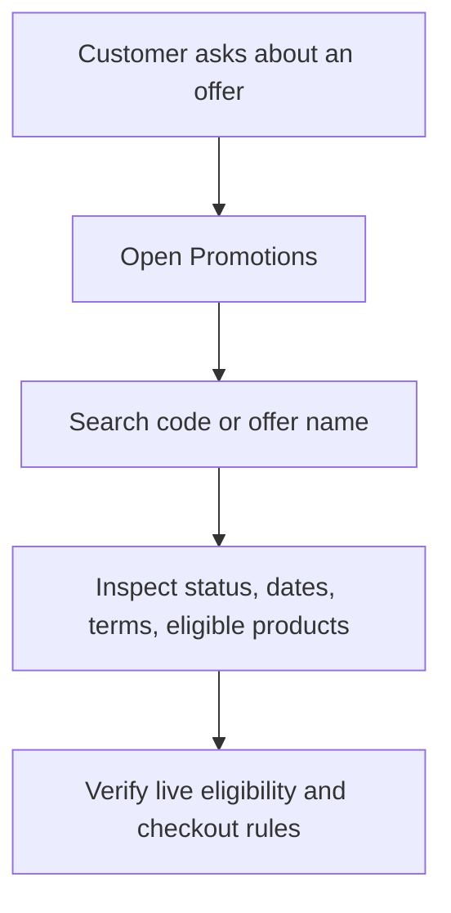

# SC2026 Mock UI — User Flows

## Policy lookup and historical review

## Design rules

- Current and archived versions appear in separate sections.
- Archived versions are marked read-only and include a warning not to use them for new customer requests.
- Search and category filters cover both sections; sorting supports effective date and title.
- Each detail view shows version metadata and links to other versions of the same topic.
- The mock data is illustrative. Production retrieval should select the approved policy version effective at the time of the interaction when investigating historical cases, and the current approved version for new answers.

## Product question

## Promotion eligibility

