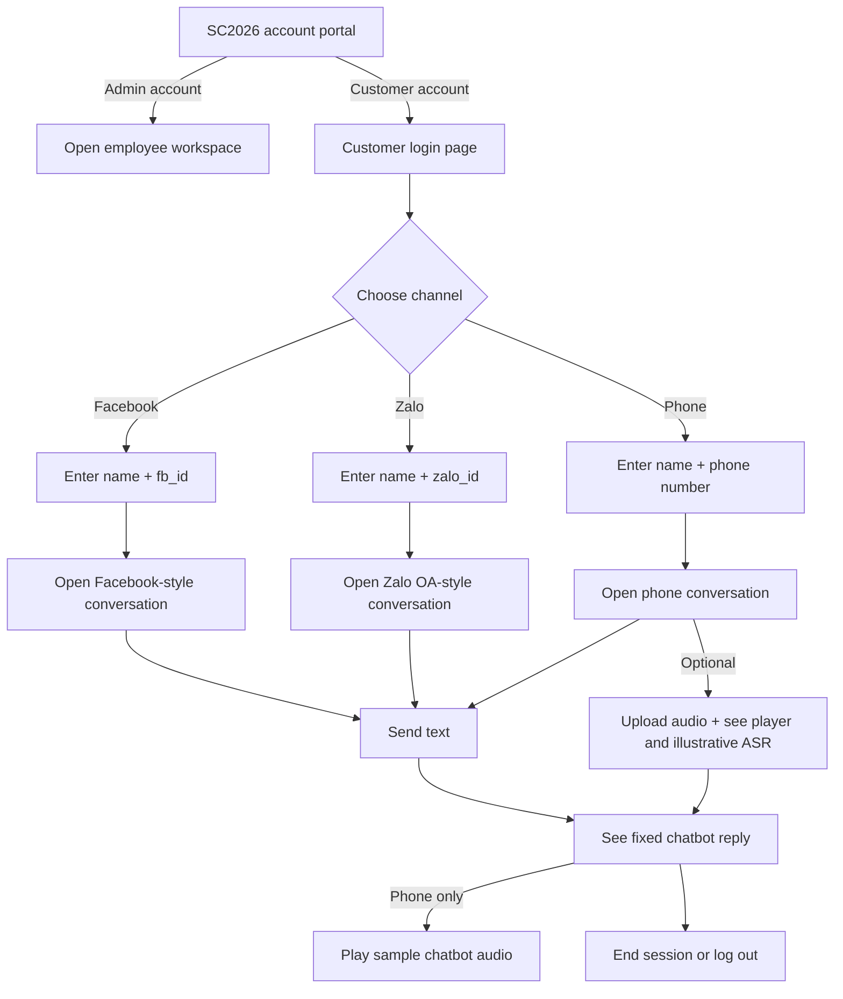
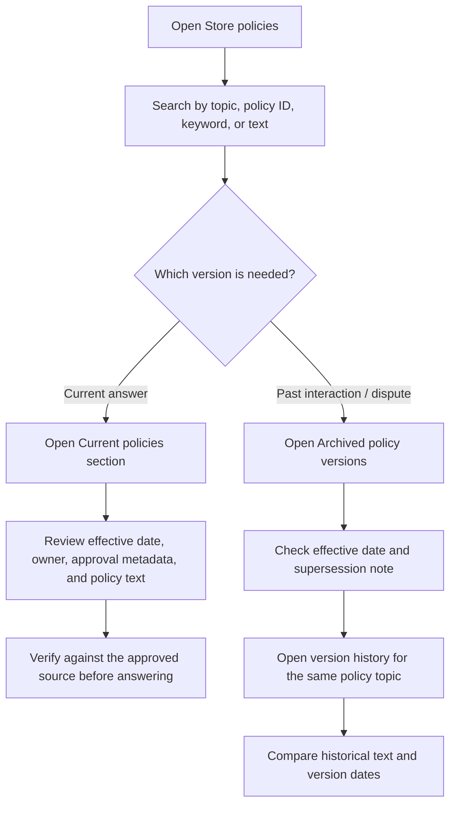
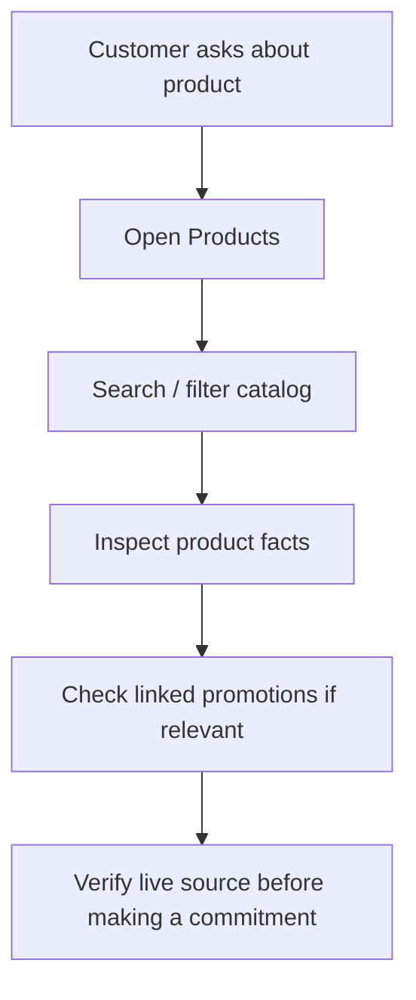
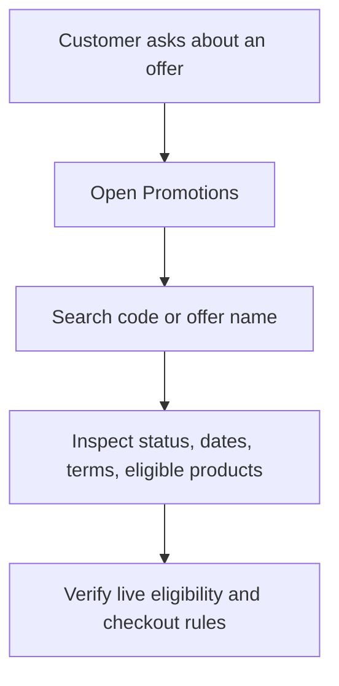

# SC2026 Mock UI — User Flows

## Separate account entry and customer login

The administrator workspace and customer portal are separate entries. Customer login is required before opening its conversation. IDs and phone numbers only simulate identity resolution. Replies and ASR are fixtures, chatbot audio is a short embedded demo sound, and uploaded audio remains local to the browser. Facebook uses a Messenger-inspired header and blue sent bubbles; Zalo uses a blue OA bar, verified-account cue, and card-like message layout.

## Policy lookup and historical review

## Design rules

- Current and archived versions appear in separate sections.
- Archived versions are marked read-only and include a warning not to use them for new customer requests.
- Search and category filters cover both sections; sorting supports effective date and title.
- Each detail view shows version metadata and links to other versions of the same topic.
- The mock data is illustrative. Production retrieval should select the approved policy version effective at the time of the interaction when investigating historical cases, and the current approved version for new answers.

## Product question

## Promotion eligibility

